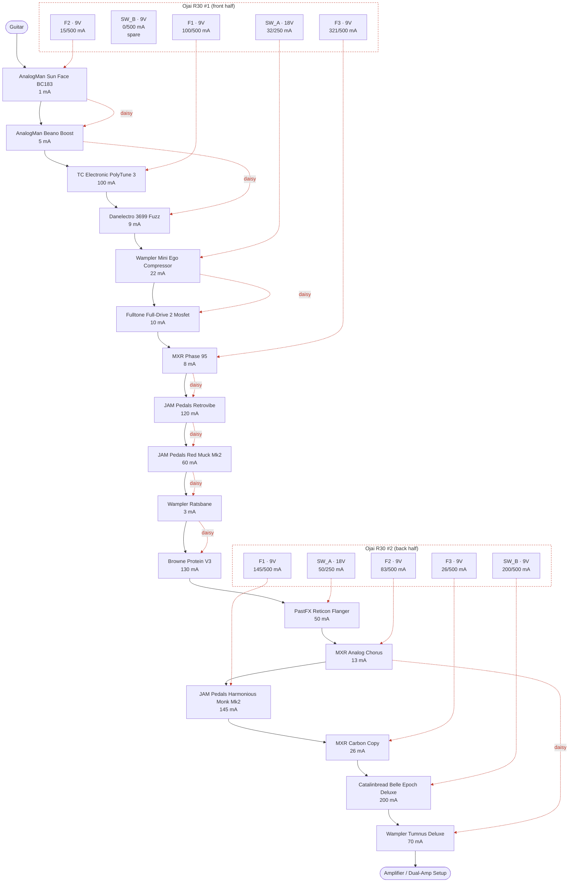

# Pedalboard plan

> Generated by `build.py` from `pedals.json` and `board.json`. Edit those files, not this one.

- `python3 build.py` validates the plan (ordering rules, output limits, digital pedals not sharing power) and regenerates this file and `pedalboard.mmd`.
- `python3 to_playground.py` writes a layout you can load into [Pedal Playground](https://pedalplayground.com/) ("Load from File").

## Signal chain

| # | Pedal | Owned | Power | Bypass | Digital | Powered from |
|--:|---|:-:|---|---|:-:|---|
| 1 | AnalogMan Sun Face BC183 | Yes | 9V, 1 mA | True | No | Ojai R30 #1 · F2 |
| 2 | AnalogMan Beano Boost | Yes | 9V, 5 mA | True | No | Ojai R30 #1 · F2 |
| 3 | TC Electronic PolyTune 3 | Yes | 9V, 100 mA | Buffered (switchable) | Yes | Ojai R30 #1 · F1 |
| 4 | Danelectro 3699 Fuzz | No | 9V, 9 mA | True | No | Ojai R30 #1 · F2 |
| 5 | Wampler Mini Ego Compressor | Yes | 18V, 22 mA | True | No | Ojai R30 #1 · SW_A |
| 6 | Fulltone Full-Drive 2 Mosfet | Yes | 18V, 10 mA | True | No | Ojai R30 #1 · SW_A |
| 7 | MXR Phase 95 | Yes | 9V, 8 mA | True | No | Ojai R30 #1 · F3 |
| 8 | JAM Pedals Retrovibe | Yes | 9V, 120 mA | True | No | Ojai R30 #1 · F3 |
| 9 | JAM Pedals Red Muck Mk2 | Yes | 9V, 60 mA | True | No | Ojai R30 #1 · F3 |
| 10 | Wampler Ratsbane | Yes | 9V, 3 mA | True | No | Ojai R30 #1 · F3 |
| 11 | Browne Protein V3 | Yes | 9V, 130 mA | Unknown | No | Ojai R30 #1 · F3 |
| 12 | PastFX Reticon Flanger | Yes | 18V, 50 mA | Unknown | No | Ojai R30 #2 · SW_A |
| 13 | MXR Analog Chorus | Yes | 9V, 13 mA | Buffered | No | Ojai R30 #2 · F2 |
| 14 | JAM Pedals Harmonious Monk Mk2 | Yes | 9V, 145 mA | True | Yes | Ojai R30 #2 · F1 |
| 15 | MXR Carbon Copy | Yes | 9V, 26 mA | True | No | Ojai R30 #2 · F3 |
| 16 | Catalinbread Belle Epoch Deluxe | Yes | 9V, 200 mA | True (switchable) | Yes | Ojai R30 #2 · SW_B |
| 17 | Wampler Tumnus Deluxe | Yes | 9V, 70 mA | Buffered (switchable) | No | Ojai R30 #2 · F2 |

**To buy:** Danelectro 3699 Fuzz

### Ordering rules

- **AnalogMan Sun Face BC183** no buffered pedal anywhere before it: AnalogMan: the Fuzz Face must see the guitar directly; no buffered pedal ahead of it
- **AnalogMan Beano Boost** no buffered pedal anywhere before it: AnalogMan: no buffered pedal ahead of the Beano
- **AnalogMan Beano Boost** must come after AnalogMan Sun Face BC183: Direct post-fuzz boost
- **TC Electronic PolyTune 3** must come after AnalogMan Sun Face BC183, AnalogMan Beano Boost: No buffer ahead of the two AnalogMan pedals
- **TC Electronic PolyTune 3** as early in the chain as possible *(preferred)*: Tuner / master front buffer
- **Danelectro 3699 Fuzz** must come after AnalogMan Sun Face BC183, AnalogMan Beano Boost *(preferred)*: Placeholder: front fuzz group, where the Double Dragon was
- **MXR Phase 95** must come before Wampler Ratsbane: Van Halen phaser-into-hard-clipping sound
- **MXR Phase 95** must come before JAM Pedals Red Muck Mk2 *(preferred)*: Original plan: pre-dirt 70s sweep
- **JAM Pedals Retrovibe** must come before Browne Protein V3, Wampler Ratsbane: Uni-Vibe feeding the dirt
- **JAM Pedals Retrovibe** must come before JAM Pedals Red Muck Mk2 *(preferred)*: Original plan: pre-dirt throbbing fuzz-vibe
- **Browne Protein V3** must come after Wampler Ratsbane: Stacks on / smooths the Ratsbane's hard clipping
- **PastFX Reticon Flanger** must come after all `gain` pedals: Modulation after the gain pedals
- **MXR Analog Chorus** must come after all `gain` pedals: Modulation after the gain pedals
- **JAM Pedals Harmonious Monk Mk2** must come after all `modulation` pedals: Tremolo after the modulation pedals
- **MXR Carbon Copy** must come after all `gain` pedals: Original plan: time-based effects after the dirt
- **Catalinbread Belle Epoch Deluxe** must come after all `gain` pedals: Original plan: time-based effects after the dirt
- **Catalinbread Belle Epoch Deluxe** must come before JHS Flight Delay: Belle Epoch ahead of the Flight Delay
- **Wampler Tumnus Deluxe** must be last in the chain: Final volume and EQ setting; also the end-of-chain buffer

### Notes per pedal

- **AnalogMan Sun Face BC183**: Silicon Fuzz Face, unbuffered: must be FIRST in the chain, guitar straight into it. Ships battery-only; check your unit has the optional DC jack. Silicon version is negative ground so sharing power is OK, but AnalogMan warns a supply can add hum/oscillation. 'Under 1 mA' is from the shared Fuzz Face page.
- **AnalogMan Beano Boost**: Germanium treble booster, direct post-fuzz. Per AnalogMan it can share a DC supply with the Sun Face and other basic fuzzes (keep that group simple). The Oct 2020 manual text read by the research agent said isolated power only / no daisy-chaining, so confirm the wording for your unit. Never 9V AC. Needs the DC jack option (battery by default). Center-negative.
- **TC Electronic PolyTune 3**: Tuner / master front buffer. 100 mA is the manual's minimum supply rating; measured draw is lower (~38 mA reported for the Mini). Bypass mode is selectable by DIP switch (true by default, buffered, or buffered with display on); buffer ENABLED in this plan as the master front buffer. Has a power-out jack for daisy-chaining.
- **Danelectro 3699 Fuzz**: Fuzz/octaver, candidate to replace the JHS Double Dragon in the front fuzz group. 9 mA is from a single retailer listing (another says 3 mA; no Danelectro spec sheet found), so planning on 9 mA. Spec lists 9V DC, supply not included; a 9V battery is reported to work. Assumed 9V only. Placement after the Beano is a placeholder: confirm.
- **Wampler Mini Ego Compressor**: Compressor. Wampler publishes 14 mA at 9V and 22 mA at 18V (figure here is the 18V one). Page does not explicitly state the jack is 18V-rated. True bypass. Listed as 'Ego Mini' in the original plan.
- **Fulltone Full-Drive 2 Mosfet**: Overdrive, more headroom at 18V. ~10 mA is from Fulltone's page for the newer v2; no manufacturer figure found for the original Mosfet model (one forum measurement: ~7 mA).
- **MXR Phase 95**: Phaser, pre-dirt for a classic 70s sweep. No battery option. True bypass. Exempt from 'modulation after gain': intentionally ahead of the dirt.
- **JAM Pedals Retrovibe**: Photocell Uni-Vibe, pre-dirt for throbbing fuzz-vibe tones. 120 mA assumes the current mk.4 (mk.3 is listed at 80-150 mA): check your version. True bypass, no battery. Exempt from 'modulation after gain': intentionally ahead of the dirt.
- **JAM Pedals Red Muck Mk2**: Russian/Civil War Muff fuzz. Sources conflict: 60 mA (JAM shop page) vs 12-15 mA (retailers); planning on 60 mA until the manual is checked. True bypass.
- **Wampler Ratsbane**: Hard-clipping distortion. 2.5 mA at 9V, 3.2 mA at 18V; approved for 18V but designed around 9V. No battery connector. True bypass.
- **Browne Protein V3**: Dual overdrive, placed post-Ratsbane to stack or smooth the hard clipping. 9V only ('18V is not better'). Fully analog (per owner), so it may share an output. Bypass type unconfirmed (V3 uses soft/electronic switching, per Browne; reviews say true bypass, Browne does not state it). This is the V3. Browne's sources conflict for V3 current: manual says <100 mA, a Browne Q&A line says 130 mA, retailers quote ~30 mA. Planning on 130 mA (worst case).
- **PastFX Reticon Flanger**: Analog BBD flanger, post-dirt modulation. Needs an isolated 18V output, no battery. Bypass type NOT FOUND in any source (do not infer from other PastFX pedals). 'Under 50 mA' is from search snippets of the PastFX page/manual (direct fetch failed): verify.
- **MXR Analog Chorus**: Analog BBD chorus (M234). Buffered bypass per the Dunlop manual (one reviewer says it dulls highs when off). Battery or 9V DC.
- **JAM Pedals Harmonious Monk Mk2**: Harmonic tremolo with digital tap controller. Analog signal path but a digital processor, so treated as DIGITAL: must not share an output. JAM recommends an isolated supply; 145 mA is JAM's max (third-party listings say 35-100 mA). True bypass.
- **MXR Carbon Copy**: Analog BBD delay (M169). 26 mA, 9V DC center-negative, true bypass (retailer specs; one UK retailer lists it as end of life). Placed just before the Belle Epoch as a placeholder: confirm the delay order. Kept on its own output rather than sharing with the chorus (two BBD circuits).
- **Catalinbread Belle Epoch Deluxe**: Tape echo emulation. Analog EP-3-style circuitry around a 24-bit digital delay line, so treated as DIGITAL. Catalinbread lists 9V DC ONLY at 200 mA (it steps up to an internal rail itself): the original plan had it on 18V, which could damage it, so it is on a 9V output here. Give it a clean isolated output. Spelled 'Epoque' in the original plan.
- **Wampler Tumnus Deluxe**: Klon-style EQ/overdrive: dead last, master mid-stack and buffer. Runs at 9V ONLY (boosts the rail internally, do not use 18V). Buffered or true bypass via side switch (buffer enabled in this plan). 70.3 mA at 9V. Deliberately not tagged 'gain' so the 'modulation after gain' rules do not apply to it.

### Not on the board

| Pedal | Owned | Power | Bypass | Digital |
|---|:-:|---|---|:-:|
| JHS Double Dragon | No | 9V, 75 mA | Buffered | No |
| Beetronics Octahive | Yes | 9V, 70 mA | True | No |
| Mooer E-Lady | Yes | 9V, 10 mA | True | No |
| MXR Custom Shop Duke of Tone | Yes | 9V, 6 mA | True | No |
| TC Electronic Ditto Looper | Yes | 9V, 100 mA | True | Yes |
| JHS Flight Delay | No | 9V, 85 mA | Unknown | Yes |

## Powering

Two Strymon Ojai R30 supplies, five isolated outputs each. Per unit, three outputs are fixed 9V / 500 mA (`F1`-`F3`) and two are switchable (`SW_A`, `SW_B`): 9V / 500 mA, 12V / 375 mA or 18V / 250 mA. Draw figures are the worst-case values in `pedals.json`. A **digital** pedal (including one with a digital processor in an analog path) always has an output to itself; the build fails if one is daisy-chained.

### Ojai R30 #1 (front half)

| Output | Voltage | Pedal | Draw (mA) | Output total |
|---|--:|---|--:|--:|
| **SW_A** (switchable) | 18V | Wampler Mini Ego Compressor | 22 | 32 / 250 mA |
|  | 18V | Fulltone Full-Drive 2 Mosfet | 10 |  |
| **SW_B** (switchable) | 9V | *spare* | 0 | 0 / 500 mA |
| **F1** (fixed) | 9V | TC Electronic PolyTune 3 | 100 | 100 / 500 mA |
| **F2** (fixed) | 9V | AnalogMan Sun Face BC183 | 1 | 15 / 500 mA |
|  | 9V | AnalogMan Beano Boost | 5 |  |
|  | 9V | Danelectro 3699 Fuzz | 9 |  |
| **F3** (fixed) | 9V | MXR Phase 95 | 8 | 321 / 500 mA |
|  | 9V | JAM Pedals Retrovibe | 120 |  |
|  | 9V | JAM Pedals Red Muck Mk2 | 60 |  |
|  | 9V | Wampler Ratsbane | 3 |  |
|  | 9V | Browne Protein V3 | 130 |  |
| | | **Ojai R30 #1 total** | | **468 mA** |

### Ojai R30 #2 (back half)

| Output | Voltage | Pedal | Draw (mA) | Output total |
|---|--:|---|--:|--:|
| **SW_A** (switchable) | 18V | PastFX Reticon Flanger | 50 | 50 / 250 mA |
| **SW_B** (switchable) | 9V | Catalinbread Belle Epoch Deluxe | 200 | 200 / 500 mA |
| **F1** (fixed) | 9V | JAM Pedals Harmonious Monk Mk2 | 145 | 145 / 500 mA |
| **F2** (fixed) | 9V | MXR Analog Chorus | 13 | 83 / 500 mA |
|  | 9V | Wampler Tumnus Deluxe | 70 |  |
| **F3** (fixed) | 9V | MXR Carbon Copy | 26 | 26 / 500 mA |
| | | **Ojai R30 #2 total** | | **504 mA** |

**Both supplies combined:** 972 mA

