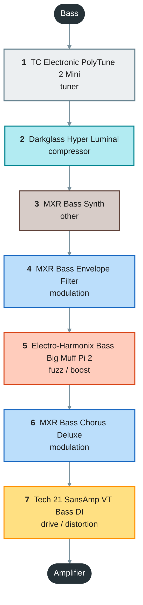
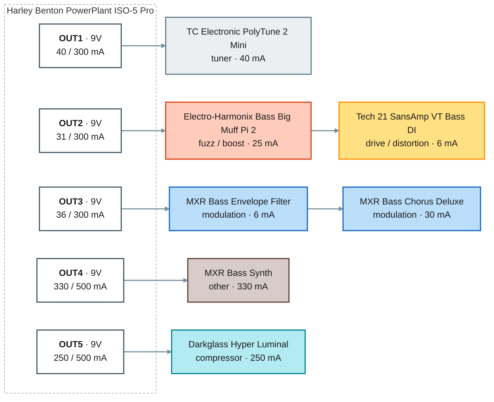
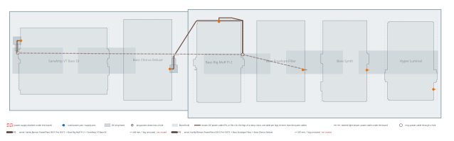
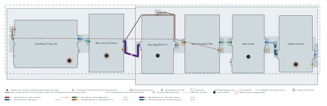

# Bass board

> Generated by `scripts/build.py` from `catalog/` and this folder's `project.json`. Edit those, not this file.

- **Instrument:** bass
- **Board:** Rockboard by Warwick Duo 2.1 (461 x 146 mm)
- **Validation:** OK, 4 warning(s) (`no_unknown` on)

<details><summary>Validation messages</summary>

- WARN layout: polytune_2_mini is in the signal chain but not in playground_design.json
- WARN layout: supply psu1 (harley_benton_iso5_pro) is not in playground_design.json
- WARN routing: P3.2 (mxr_bass_envelope_filter.power -> mxr_bass_chorus_deluxe.power) runs 173 mm on top of the board (power cables should stay under it: no usable hole or edge near the pedal's power jack)
- WARN footswitches: no footswitch data for 1 of 7 pedals (mxr_bass_envelope_filter) -> run: uv run scripts/pedal_editor.py --list-missing bass --only footswitches

</details>

## Signal chain



| # | Pedal | Owned | Accepts | Runs at | Draw | Bypass | Digital | Powered from |
|--:|---|:-:|---|---|--:|---|:-:|---|
| 1 | TC Electronic PolyTune 2 Mini | Yes | 9V | 9V | 40 mA | True | Yes | Harley Benton PowerPlant ISO-5 Pro · OUT1 |
| 2 | Darkglass Hyper Luminal | Yes | 9V | 9V | 250 mA | Buffered | Yes | Harley Benton PowerPlant ISO-5 Pro · OUT5 |
| 3 | MXR Bass Synth | No | 9V | 9V | 330 mA | True | Yes | Harley Benton PowerPlant ISO-5 Pro · OUT4 |
| 4 | MXR Bass Envelope Filter | No | 9V | 9V | 6 mA | True | No | Harley Benton PowerPlant ISO-5 Pro · OUT3 |
| 5 | Electro-Harmonix Bass Big Muff Pi 2 | Yes | 9-12V | 9V | 25 mA | True | No | Harley Benton PowerPlant ISO-5 Pro · OUT2 |
| 6 | MXR Bass Chorus Deluxe | No | 9V | 9V | 30 mA | True | No | Harley Benton PowerPlant ISO-5 Pro · OUT3 |
| 7 | Tech 21 SansAmp VT Bass DI | Yes | 9V | 9V | 6 mA | Buffered | No | Harley Benton PowerPlant ISO-5 Pro · OUT2 |

**To buy:** MXR Bass Synth, MXR Bass Envelope Filter, MXR Bass Chorus Deluxe

### Ordering rules

- **TC Electronic PolyTune 2 Mini** must be first in the chain (priority 50): Tuner first (outranks the compressor's 'first') `[project]`
- **Darkglass Hyper Luminal** must be first in the chain (priority 10): Compressor first, right after the tuner `[project]`
- **MXR Bass Synth** must come before all `gain` pedals: Synth before the drive pedals `[project]`
- **Tech 21 SansAmp VT Bass DI** must be last in the chain: Preamp / DI last `[project]`
- **MXR Bass Envelope Filter** must come before all `gain` pedals: Envelope filter before the drive pedals (owner's layout, 2026-11-09) `[project]`
- **MXR Bass Chorus Deluxe** must come after Electro-Harmonix Bass Big Muff Pi 2: Chorus after the fuzz, before the preamp / DI (owner's layout, 2026-11-09) `[project]`
- **Electro-Harmonix Bass Big Muff Pi 2** must come before all `overdrive` pedals: Fuzz comes before any drive pedal `[project]`

### Overridden by priority

- `polytune_2_mini.first` overrides `darkglass_hyper_luminal.first` for: darkglass_hyper_luminal before polytune_2_mini

### Notes per pedal

- **TC Electronic PolyTune 2 Mini**: Currently planned for the bass board (may move to the practice board). The Mini, not the full-size PolyTune 2 (owner confirmed). About 40 mA typical per TC's specs, 9V DC center-negative, adapter not included; no battery operation on the Mini. True bypass (no buffer); output mutes while tuning. Digital is inferred from the polyphonic display (no source states it explicitly). Power re-checked 2026-10-21: 40 mA typical (retailer); one Q&A says use a 100 mA supply; no maker figure found.
- **Darkglass Hyper Luminal**: Planned for the bass board. Analog VCA audio path controlled by a digital side-chain (time constants editable via the Darkglass Suite), so treated as DIGITAL: must not share an output. 250 mA at 9V DC center-negative, REGULATED supply only (unregulated or higher voltage can cause noise/damage); no battery option listed. Buffered bypass (per owner; the manufacturer is silent and retailers conflict). Reported discontinued or out of stock at several retailers.
- **MXR Bass Synth**: Planned for the bass board; on the to-buy list. MB301. 330 mA at 9V DC center-negative per retailer specs; cannot run on a battery. Has a DSP, so treated as DIGITAL: must not share an output (per owner; one retailer lists it as analog). True bypass (per owner).
- **MXR Bass Envelope Filter**: MXR M82, to buy for the bass board. All-analog envelope filter (not BBD, no DSP): digital false, clocked_noise false. Controls Dry, FX, Decay, Q, Sens. Dunlop manual: 6 mA at 9 V DC (Minitone's 8 mA disagrees; the maker figure is used); center-negative per effektpedaler.dk and ModularGrid; battery, ECB003 adapter or DC Brick also work. 'Filter' tag is new in this catalog (modulation + filter).
- **Electro-Harmonix Bass Big Muff Pi 2**: Planned for the bass board. 2026 small-enclosure reissue (not the original large Bass Big Muff Pi: that one draws 7 mA). ehx.com says 25 mA in the power section and 20 mA in the spec list (planning on 25); 9V DC center-negative, do not exceed 12V; battery included. Analog circuit, true bypass via mechanical relay. Power re-checked 2026-10-21: EHX says do not exceed 12VDC at the jack, so 9-12V.
- **MXR Bass Chorus Deluxe**: MXR M83, to buy for the bass board. Analog bucket-brigade (BBD) chorus / flanger with X-Over (no effect below about 100 Hz), so clocked_noise true, digital false (Dunlop manual: 'Analog bucket brigade technology'). Supply: 9 V DC, 30 mA (Dunlop manual 'Current Draw 30 mA, Power Supply 9 volts DC'; Amazon's 9 mA looks like an error). Polarity center-negative is the MXR standard but NOT stated in the manual or Bonedo (unverified; also battery or Dunlop ECB003 / Brick). Internal switch: mono true bypass or TRS stereo hardwire bypass (stereo output is not planned). Three status LEDs.
- **Tech 21 SansAmp VT Bass DI**: Planned for the bass board. Preamp / stompbox / XLR DI with a Drive control, so it counts as a gain / overdrive pedal. About 6 mA at 9V DC center-negative (100 mA minimum supply rating per the manual); also runs on 9V battery or 24-48V phantom power. 100% analog. Not true bypass: with the SansAmp circuit off it acts as an active transparent direct box, so the input buffer and XLR driver stay active (the manual does not call it 'buffered' explicitly).

## Powering

Every output and the pedals daisy-chained on it, grouped for power (not in signal order); colors are the effect categories, a red border marks an 18V output.



Draw figures are the worst-case values in `catalog/pedals.json`. Pedals are daisy-chained by **effect type**, not by chain order: time-based/clocked effects (BBD or digital) never share an output with compressors or gain pedals, a **digital** pedal (including one with a digital processor in an analog path) always has an output to itself, and 18V-capable pedals share 18V outputs. The build checks all three (policy in `project.json`: `power_policy`).

### Harley Benton PowerPlant ISO-5 Pro

Placement: under the board. Layout item: not in the layout.

| Output | Voltage | Pedal | Draw (mA) | Output total |
|---|--:|---|--:|--:|
| **OUT1** (fixed) | 9V | TC Electronic PolyTune 2 Mini | 40 | 40 / 300 mA |
| **OUT2** (fixed) | 9V | Electro-Harmonix Bass Big Muff Pi 2 | 25 | 31 / 300 mA |
|  | 9V | Tech 21 SansAmp VT Bass DI | 6 |  |
| **OUT3** (fixed) | 9V | MXR Bass Envelope Filter | 6 | 36 / 300 mA |
|  | 9V | MXR Bass Chorus Deluxe | 30 |  |
| **OUT4** (switchable) | 9V | MXR Bass Synth | 330 | 330 / 500 mA |
| **OUT5** (switchable) | 9V | Darkglass Hyper Luminal | 250 | 250 / 500 mA |
| | | **Harley Benton PowerPlant ISO-5 Pro total** | | **687 mA** |

**All supplies combined:** 687 mA


## Jacks and cables

Jack data: 8 of 8 catalog items set up (pedals and supplies in this project).

No blocked cable space found (signal jacks with a cable type: the plug head plus its cable exit on the side the router chose (see Cable routing); power jacks: the DC plug head plus its cable exit on the less blocked side; other jacks: 6.3 mm outward, 7 mm to each side).

DC plugs that pass under a signal plug (a right-angle DC plug is plugged diagonally and its cable goes under the patch cables; not a collision, one pass per plug):

- P5 (darkglass_hyper_luminal.power) passes under the plug at darkglass_hyper_luminal.in: plug it diagonally
- P3.2 (mxr_bass_chorus_deluxe.power) passes under the plug at mxr_bass_chorus_deluxe.in: plug it diagonally
- P2.2 (tech21_vt_bass_di.power) passes under the plug at tech21_vt_bass_di.out: plug it diagonally

Cable lengths: see Cable routing.


## Cable routing

Signal cables are routed on the board surface between the pedals: never in front of the lowest pedals, at most 3.5 mm beyond the board edges at the back and sides, at most 2 cables stacked in one 2 mm cell (cable width on the board 3.5 mm). A cable may also pass under the board when that is shorter or less crowded: it goes down in a hole cell (a grid cell whose centre lies in a hole that no pedal covers), runs under the board (only the under-board supplies are obstacles there, at most 2 cables stacked) and comes up in a hole. A pass through the deck adds 15 mm of cable, each costs 15 mm more in the search, a mm under the board counts 0.9 in the search (these numbers are unverified estimates; `cables.under_board: false` keeps every cable on top). Plugs are modelled (default cable type `ernie_ball_flat_patch_ra`, catalog/cables.json): a right-angle plug's cable leaves the head to the left or right of the jack's facing (chosen per end: fewest blocked plugs and plug collisions, then the shortest route), runs 3.5 mm straight, then is routed. A right-angle plug may also point straight down into a board hole (`down` in the Exits column; the square of one cable width at the plug's bend point must lie inside the holes and clear of the under-board supplies): where that is possible it is always chosen, even if the cable gets longer, and the cable continues under the board. The cable down to the hole is the jack height (`cables.jack_height_mm`, 12 mm, an unverified estimate of the jack axis above the deck) plus the deck (15 mm). `cables.overrides.<id>.exit_a` / `exit_b` accept `down`. Power cables are routed with the same router on their own grid (3.2 mm wide; plug `dc_ra_2_1_low_profile`, exit side in the Exits column) and count against each other only: at most 2 stacked per cell and layer, at most 2 across a power plug. They stay under the board as much as they can: a cable from an under-board supply port starts under the board and comes up through the usable hole nearest its pedal's power jack (a hole cell no pedal covers) or round the board edge along an edge segment the owner drew in the board editor (`board.json`, type `edge`; none drawn: holes only; with neither holes nor edge segments an under-board supply is an error), then runs the short way on top to the jack; a hop from a pedal's power jack (daisy chain) or from an on-board supply starts on top. In the search a mm on top counts 3 (under the board 1). A pass through a hole adds 15 mm of cable and a crossing of the board edge 30 mm (both unverified estimates; the edge value is twice the hole transit). A power cable that runs more than 150 mm on top is reported.



`power.svg` shows the power wiring alone: the supplies as translucent red silhouettes (dashed when they hang under the board), the pedals faint, the power jacks and supply ports, the DC cables (dashed under the board, a ring at each hole, a square at each board edge) and a table of the power cables.

Pedals are obstacles by their outlines (`catalog/outlines.json`), their Pedal Playground box where there is none. No outline: MXR Bass Chorus Deluxe, MXR Bass Envelope Filter.



The picture (`routing.svg`) is drawn in mm and prints at 1:1 from a browser: the board, the routing area (dashed), the pedals, every jack (coloured by function, filled when used, the tick on the side the plug enters from), the plug heads (grey boxes) with their cable exits, the cables (one colour each; side by side in lanes where they share a corridor, white dashes where they are stacked; under the board: lighter and dashed, a ring at each hole pass, a square at each edge pass, the edge segments as thick purple lines on the board border), the footswitches and a legend table with each cable's minimum length. `uv run scripts/build.py --images` also writes the git-ignored `routing.local.svg` with the pedal images.

Min length = the shortest cable that reaches: measured from a point on each jack's axis half the clearance depth in front of the jack (half the plug head depth), along the plug's cable exit and the routed path. No slack or rounding is added. '~' marks a power cable that is not routed: a right-angle estimate between its jacks (with the project's default DC plug type). A routed power cable's Under board column gives its passes (holes, edges), the mm under the board and the mm on top. A power cable you buy is P#; a daisy chain with several plugs is one cable whose legs (plug to plug) are P#.1, P#.2... (see the table of DC cables to buy below).

| Cable | Kind | From | To | Type | Exits | Tips | Polarity | Under board | Min length (mm) | Status |
|---|---|---|---|---|---|---|---|:-:|--:|---|
| S1 | signal | polytune_2_mini.out | darkglass_hyper_luminal.in | ernie_ball_flat_patch_ra | - / left | TS / TS | - | no | ? | not routed (jack or placement missing) |
| S2 | signal | darkglass_hyper_luminal.out | mxr_bass_synth.in | ernie_ball_flat_patch_ra | right / down | TS / TS | - | yes (1 hole, 16 mm) | 81 | routed |
| S3 | signal | mxr_bass_synth.out | mxr_bass_envelope_filter.in | ernie_ball_flat_patch_ra | down / down | TS / TS | - | yes (no pass, 16 mm) | 70 | routed |
| S4 | signal | mxr_bass_envelope_filter.out | ehx_bass_big_muff_2.in | ernie_ball_flat_patch_ra | down / down | TS / TS | - | yes (no pass, 13 mm) | 67 | routed |
| S5 | signal | ehx_bass_big_muff_2.out | mxr_bass_chorus_deluxe.in | ernie_ball_flat_patch_ra | left / right | TS / TS | - | no | 71 | routed |
| S6 | signal | mxr_bass_chorus_deluxe.out | tech21_vt_bass_di.in | ernie_ball_flat_patch_ra | down / down | TS / TS | - | yes (no pass, 16 mm) | 70 | routed |
| P1 | power | psu1.OUT1 | polytune_2_mini.power | dc_ra_2_1_low_profile | - / - | DC 2.1 mm / DC 2.1 mm | center_negative | yes | ? | not routed (power jack or placement missing) |
| P2.1 | power | psu1.OUT2 | ehx_bass_big_muff_2.power | dc_ra_2_1_low_profile | - / right | DC 2.1 mm / DC 2.1 mm | center_negative | yes | ? | not routed (supply port position unknown) |
| P2.2 | power | ehx_bass_big_muff_2.power | tech21_vt_bass_di.power | dc_ra_2_1_low_profile | - / left | DC 2.1 mm / DC 2.1 mm | center_negative | 2 holes; 316 mm under, 65 mm on top | 446 | routed |
| P3.1 | power | psu1.OUT3 | mxr_bass_envelope_filter.power | dc_ra_2_1_low_profile | - / down | DC 2.1 mm / DC 2.1 mm | center_negative | yes | ? | not routed (supply port position unknown) |
| P3.2 | power | mxr_bass_envelope_filter.power | mxr_bass_chorus_deluxe.power | dc_ra_2_1_low_profile | - / left | DC 2.1 mm / DC 2.1 mm | center_negative | 1 hole; 93 mm under, 173 mm on top | 325 | routed |
| P4 | power | psu1.OUT4 | mxr_bass_synth.power | dc_ra_2_1_low_profile | - / down | DC 2.1 mm / DC 2.1 mm | center_negative | yes | ? | not routed (supply port position unknown) |
| P5 | power | psu1.OUT5 | darkglass_hyper_luminal.power | dc_ra_2_1_low_profile | - / left | DC 2.1 mm / DC 2.1 mm | center_negative | yes | ? | not routed (supply port position unknown) |

Signal cable, minimum: 359 mm over 5 cables.

### DC cables to buy

Each row is one DC cable P#. A **serial** output is one cable that runs from the supply port to the first pedal and on to the next ones (a plug at the port and one at each pedal); its legs P#.1, P#.2... (in daisy order, P#.1 starts at the supply port) are the stretches between two consecutive plugs, and the minimum spacing between those plugs is each leg's minimum length. A cable with a single leg is just P#. A **forked** output has one cable per pedal, each from the supply port (a splitter or several plugs at the port). The cable's minimum length is the sum of its legs; lengths are minimums, as above ('~': a right-angle estimate with the default DC plug type, the cable is not routed).

| DC cable | Style | Output | Route | Plugs | Min plug spacing per leg (mm) | Min length (mm) | Status |
|---|---|---|---|--:|---|--:|---|
| P1 | serial | psu1_OUT1 | psu1.OUT1 -> polytune_2_mini | 2 | - | ? | not routed (power jack or placement missing) |
| P2 | serial | psu1_OUT2 | psu1.OUT2 -> ehx_bass_big_muff_2 -> tech21_vt_bass_di | 3 | P2.1 ? / P2.2 446 | ? | not routed (supply port position unknown) |
| P3 | serial | psu1_OUT3 | psu1.OUT3 -> mxr_bass_envelope_filter -> mxr_bass_chorus_deluxe | 3 | P3.1 ? / P3.2 325 | ? | not routed (supply port position unknown) |
| P4 | serial | psu1_OUT4 | psu1.OUT4 -> mxr_bass_synth | 2 | - | ? | not routed (supply port position unknown) |
| P5 | serial | psu1_OUT5 | psu1.OUT5 -> darkglass_hyper_luminal | 2 | - | ? | not routed (supply port position unknown) |

## Footswitches

Footswitch data: 6 of 7 pedals (catalog/footswitches.json).

Missing (place the switches on the pedal image, then rebuild):

```
uv run scripts/pedal_editor.py mxr_bass_envelope_filter --footswitches
```

Spacing is comfort, not a hard rule: switches of different pedals should be as far apart as the other goals allow. Crowding of a pair = priority x (comfort - distance)^2 / comfort for pairs closer than the comfort distance (100 mm, `footswitches.comfort_mm`; distance centre to centre; priority per switch type, `footswitches.priority`); lower is better, the layout proposals minimise it. No minimum distance is set. Switches on the same pedal are not checked. Type: bypass (turns the pedal, or one side of it, on and off), tap (tap tempo), boost (a boost / extra-gain stomp), function (any other switch).

Toppers (a larger, higher cap on a switch) are a finishing step after the layout; the layout search ignores them. A topper adds 4.5 mm (`footswitches.topper_bonus_mm`; default: the height a topper adds, a rough proxy, unverified) to the effective distance of every pair its switch is in (both switches of a pair: twice); crowding uses the effective distance. No toppers are set.

Crowding: 7.5 (3 of 10 pairs closer than 100 mm). Closest pairs (8 of 10):

| Switch | Type | Switch | Type | Distance (mm) | Crowding |
|---|---|---|---|--:|--:|
| mxr_bass_chorus_deluxe.bypass | bypass | tech21_vt_bass_di.bypass | bypass | 73.2 | 7.2 |
| darkglass_hyper_luminal.bypass | bypass | mxr_bass_synth.bypass | bypass | 93.9 | 0.4 |
| ehx_bass_big_muff_2.bypass | bypass | mxr_bass_chorus_deluxe.bypass | bypass | 99.8 | 0.0 |
| ehx_bass_big_muff_2.bypass | bypass | tech21_vt_bass_di.bypass | bypass | 172.6 | 0.0 |
| mxr_bass_synth.bypass | bypass | ehx_bass_big_muff_2.bypass | bypass | 176.9 | 0.0 |
| darkglass_hyper_luminal.bypass | bypass | ehx_bass_big_muff_2.bypass | bypass | 270.1 | 0.0 |
| mxr_bass_synth.bypass | bypass | mxr_bass_chorus_deluxe.bypass | bypass | 276.7 | 0.0 |
| mxr_bass_synth.bypass | bypass | tech21_vt_bass_di.bypass | bypass | 349.3 | 0.0 |

### Suggested toppers

Chosen after the layout (never during the search), on bypass switches only (a tap switch gets one by hand, a boost switch never), greedily: the topper that removes the most crowding first (a switch in several close pairs helps them all; ties: the switch in more crowded pairs, then the higher priority type, then nearer the front), at most 5 in all (`footswitches.max_toppers`), stopping when a topper would remove less than 2 % of the crowding (`footswitches.topper_min_gain`). Not applied: list the ones you want in `footswitches.toppers`.

| # | Switch | Pedal | Type | Crowding removed | Crowding after |
|--:|---|---|---|--:|--:|
| 1 | mxr_bass_chorus_deluxe.bypass (Bypass) | MXR Bass Chorus Deluxe | bypass | 2.2 | 5.3 |
| 2 | tech21_vt_bass_di.bypass (Bypass) | Tech 21 SansAmp VT Bass DI | bypass | 1.8 | 3.5 |
| 3 | darkglass_hyper_luminal.bypass (Bypass) | Darkglass Hyper Luminal | bypass | 0.3 | 3.2 |


## Layout proposals

None yet: `uv run scripts/propose_layout.py bass` searches for better pedal positions (it never changes playground_design.json).

