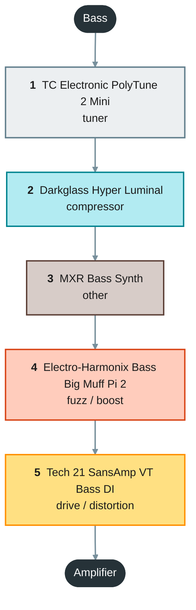
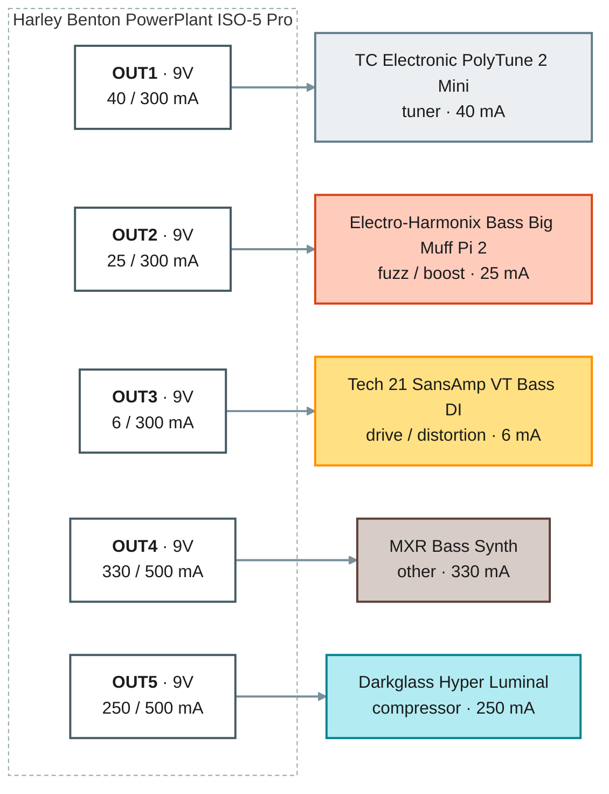

# Bass board

> Generated by `scripts/build.py` from `catalog/` and this folder's `project.json`. Edit those, not this file.

- **Instrument:** bass
- **Board:** Rockboard by Warwick Duo 2.1 (461 x 146 mm)
- **Validation:** OK, 1 warning(s) (`no_unknown` on)

Validation messages

- WARN jacks: harley_benton_iso5_pro (Harley Benton PowerPlant ISO-5 Pro) has no playground_title, so there is no image to mark jacks on

## Signal chain

| # | Pedal | Owned | Accepts | Runs at | Draw | Bypass | Digital | Powered from |
|--:|---|:-:|---|---|--:|---|:-:|---|
| 1 | TC Electronic PolyTune 2 Mini | Yes | 9V | 9V | 40 mA | True | Yes | Harley Benton PowerPlant ISO-5 Pro · OUT1 |
| 2 | Darkglass Hyper Luminal | Yes | 9V | 9V | 250 mA | Buffered | Yes | Harley Benton PowerPlant ISO-5 Pro · OUT5 |
| 3 | MXR Bass Synth | No | 9V | 9V | 330 mA | True | Yes | Harley Benton PowerPlant ISO-5 Pro · OUT4 |
| 4 | Electro-Harmonix Bass Big Muff Pi 2 | Yes | 9-12V | 9V | 25 mA | True | No | Harley Benton PowerPlant ISO-5 Pro · OUT2 |
| 5 | Tech 21 SansAmp VT Bass DI | Yes | 9V | 9V | 6 mA | Buffered | No | Harley Benton PowerPlant ISO-5 Pro · OUT3 |

**To buy:** MXR Bass Synth

### Ordering rules

- **TC Electronic PolyTune 2 Mini** must be first in the chain (priority 50): Tuner first (outranks the compressor's 'first') `[project]`
- **Darkglass Hyper Luminal** must be first in the chain (priority 10): Compressor first, right after the tuner `[project]`
- **MXR Bass Synth** must come before all `gain` pedals: Synth before the drive pedals `[project]`
- **Tech 21 SansAmp VT Bass DI** must be last in the chain: Preamp / DI last `[project]`
- **Electro-Harmonix Bass Big Muff Pi 2** must come before all `overdrive` pedals: Fuzz comes before any drive pedal `[project]`

### Overridden by priority

- `polytune_2_mini.first` overrides `darkglass_hyper_luminal.first` for: darkglass_hyper_luminal before polytune_2_mini

### Notes per pedal

- **TC Electronic PolyTune 2 Mini**: Currently planned for the bass board (may move to the practice board). The Mini, not the full-size PolyTune 2 (owner confirmed). About 40 mA typical per TC's specs, 9V DC center-negative, adapter not included; no battery operation on the Mini. True bypass (no buffer); output mutes while tuning. Digital is inferred from the polyphonic display (no source states it explicitly). Power re-checked 2026-10-21: 40 mA typical (retailer); one Q&A says use a 100 mA supply; no maker figure found.
- **Darkglass Hyper Luminal**: Planned for the bass board. Analog VCA audio path controlled by a digital side-chain (time constants editable via the Darkglass Suite), so treated as DIGITAL: must not share an output. 250 mA at 9V DC center-negative, REGULATED supply only (unregulated or higher voltage can cause noise/damage); no battery option listed. Buffered bypass (per owner; the manufacturer is silent and retailers conflict). Reported discontinued or out of stock at several retailers.
- **MXR Bass Synth**: Planned for the bass board; on the to-buy list. MB301. 330 mA at 9V DC center-negative per retailer specs; cannot run on a battery. Has a DSP, so treated as DIGITAL: must not share an output (per owner; one retailer lists it as analog). True bypass (per owner).
- **Electro-Harmonix Bass Big Muff Pi 2**: Planned for the bass board. 2026 small-enclosure reissue (not the original large Bass Big Muff Pi: that one draws 7 mA). ehx.com says 25 mA in the power section and 20 mA in the spec list (planning on 25); 9V DC center-negative, do not exceed 12V; battery included. Analog circuit, true bypass via mechanical relay. Power re-checked 2026-10-21: EHX says do not exceed 12VDC at the jack, so 9-12V.
- **Tech 21 SansAmp VT Bass DI**: Planned for the bass board. Preamp / stompbox / XLR DI with a Drive control, so it counts as a gain / overdrive pedal. About 6 mA at 9V DC center-negative (100 mA minimum supply rating per the manual); also runs on 9V battery or 24-48V phantom power. 100% analog. Not true bypass: with the SansAmp circuit off it acts as an active transparent direct box, so the input buffer and XLR driver stay active (the manual does not call it 'buffered' explicitly).

## Powering

Every output and the pedals daisy-chained on it, grouped for power (not in signal order); colors are the effect categories, a red border marks an 18V output.

Draw figures are the worst-case values in `catalog/pedals.json`. Pedals are daisy-chained by **effect type**, not by chain order: time-based/clocked effects (BBD or digital) never share an output with compressors or gain pedals, a **digital** pedal (including one with a digital processor in an analog path) always has an output to itself, and 18V-capable pedals share 18V outputs. The build checks all three (policy in `project.json`: `power_policy`).

### Harley Benton PowerPlant ISO-5 Pro

Placement: under the board. Layout item: no layout.

| Output | Voltage | Pedal | Draw (mA) | Output total |
|---|--:|---|--:|--:|
| **OUT1** (fixed) | 9V | TC Electronic PolyTune 2 Mini | 40 | 40 / 300 mA |
| **OUT2** (fixed) | 9V | Electro-Harmonix Bass Big Muff Pi 2 | 25 | 25 / 300 mA |
| **OUT3** (fixed) | 9V | Tech 21 SansAmp VT Bass DI | 6 | 6 / 300 mA |
| **OUT4** (switchable) | 9V | MXR Bass Synth | 330 | 330 / 500 mA |
| **OUT5** (switchable) | 9V | Darkglass Hyper Luminal | 250 | 250 / 500 mA |
| | | **Harley Benton PowerPlant ISO-5 Pro total** | | **651 mA** |

**All supplies combined:** 651 mA

## Jacks and cables

Jack data: 5 of 6 catalog items set up (pedals and supplies in this project).

*no playground_design.json: cable lengths and clearance are not checked.*

## Cable routing

Signal cables are routed on the board surface between the pedals: never under the board, never in front of the lowest pedals, at most 3.5 mm beyond the back and sides, at most 2 cables stacked in one 2 mm cell (cable width on the board 3.5 mm). Plugs are modelled (default cable type `ernie_ball_flat_patch_ra`, catalog/cables.json): a right-angle plug's cable leaves the head to the left or right of the jack's facing (chosen per end: fewest blocked plugs, then the shortest route), runs 3.5 mm straight, then is routed. Power cables run under the board and are listed, not routed yet; their plug at each pedal's power jack is modelled for clearance (`dc_ra_2_1_low_profile`, exit side in the Exits column).

Min length = the shortest cable that reaches: measured from a point on each jack's axis half the clearance depth in front of the jack (half the plug head depth), along the plug's cable exit and the routed path. No slack or rounding is added. '~' marks a power cable: a right-angle estimate between its jacks (power cables are not routed).

| Cable | Kind | From | To | Type | Exits | Tips | Polarity | Under board | Min length (mm) | Status |
|---|---|---|---|---|---|---|---|:-:|--:|---|
| S1 | signal | polytune_2_mini.out | darkglass_hyper_luminal.in | ernie_ball_flat_patch_ra | - / - | TS / TS | - | no | ? | not routed |
| S2 | signal | darkglass_hyper_luminal.out | mxr_bass_synth.in | ernie_ball_flat_patch_ra | - / - | TS / TS | - | no | ? | not routed |
| S3 | signal | mxr_bass_synth.out | ehx_bass_big_muff_2.in | ernie_ball_flat_patch_ra | - / - | TS / TS | - | no | ? | not routed |
| S4 | signal | ehx_bass_big_muff_2.out | tech21_vt_bass_di.in | ernie_ball_flat_patch_ra | - / - | TS / TS | - | no | ? | not routed |

## Footswitches

Footswitch data: 5 of 5 pedals (catalog/footswitches.json).

*No playground_design.json: footswitch spacing is not checked.*

