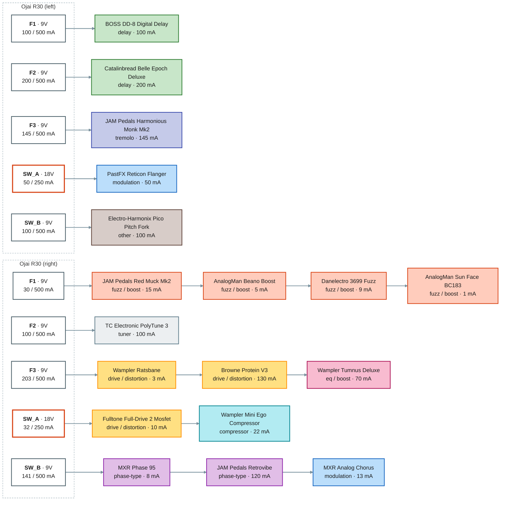
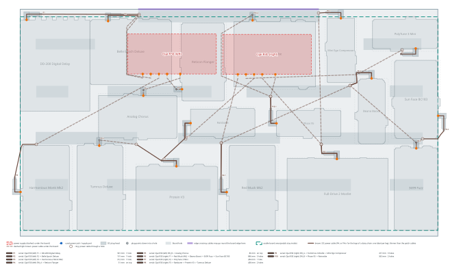
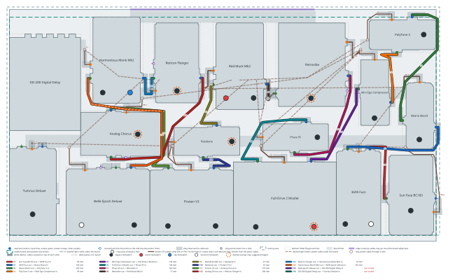
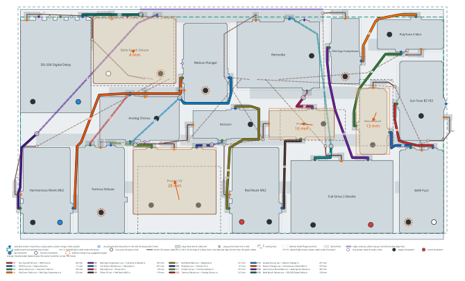
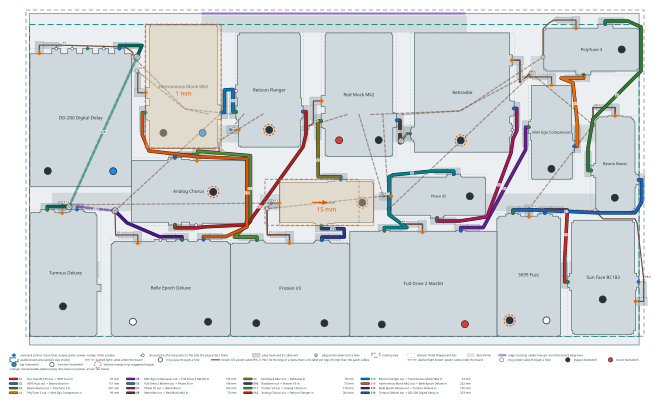

# Guitar gig board

> Generated by `scripts/build.py` from `catalog/` and this folder's `project.json`. Edit those, not this file.

- **Instrument:** guitar
- **Board:** Fender Professional (Medium) (610 x 332 mm)
- **Validation:** OK, 1 warning(s) (`no_unknown` on)

Validation messages

- WARN clearance: monk.power (Power, facing left, dc_ra_owner_baseline right-angle plug, cable exits right) is blocked by Wampler Tumnus Deluxe: it reaches 1.1 mm into the plug's head

## Signal chain

```mermaid
flowchart TB
    guitar(["Guitar"]):::endpoint
    sun_face["<b>1</b> &nbsp;AnalogMan Sun Face BC183<br/>fuzz / boost"]:::c_fuzz___boost
    danelectro_3699["<b>2</b> &nbsp;Danelectro 3699 Fuzz<br/>fuzz / boost"]:::c_fuzz___boost
    beano["<b>3</b> &nbsp;AnalogMan Beano Boost<br/>fuzz / boost"]:::c_fuzz___boost
    polytune_3["<b>4</b> &nbsp;TC Electronic PolyTune 3<br/>tuner"]:::c_tuner
    mini_ego["<b>5</b> &nbsp;Wampler Mini Ego Compressor<br/>compressor"]:::c_compressor
    ehx_pico_pitch_fork["<b>6</b> &nbsp;Electro-Harmonix Pico Pitch Fork<br/>other"]:::c_other
    fulldrive_2["<b>7</b> &nbsp;Fulltone Full-Drive 2 Mosfet<br/>drive / distortion"]:::c_drive___distortion
    phase_95["<b>8</b> &nbsp;MXR Phase 95<br/>phase-type"]:::c_phase_type
    retrovibe["<b>9</b> &nbsp;JAM Pedals Retrovibe<br/>phase-type"]:::c_phase_type
    red_muck["<b>10</b> &nbsp;JAM Pedals Red Muck Mk2<br/>fuzz / boost"]:::c_fuzz___boost
    ratsbane["<b>11</b> &nbsp;Wampler Ratsbane<br/>drive / distortion"]:::c_drive___distortion
    protein["<b>12</b> &nbsp;Browne Protein V3<br/>drive / distortion"]:::c_drive___distortion
    analog_chorus["<b>13</b> &nbsp;MXR Analog Chorus<br/>modulation"]:::c_modulation
    reticon["<b>14</b> &nbsp;PastFX Reticon Flanger<br/>modulation"]:::c_modulation
    monk["<b>15</b> &nbsp;JAM Pedals Harmonious Monk Mk2<br/>tremolo"]:::c_tremolo
    belle_epoch["<b>16</b> &nbsp;Catalinbread Belle Epoch Deluxe<br/>delay"]:::c_delay
    boss_dd8["<b>17</b> &nbsp;BOSS DD-8 Digital Delay<br/>delay"]:::c_delay
    tumnus_deluxe["<b>18</b> &nbsp;Wampler Tumnus Deluxe<br/>eq / boost"]:::c_eq___boost
    amp(["Amplifier"]):::endpoint
    guitar --> sun_face --> danelectro_3699 --> beano --> polytune_3 --> mini_ego --> ehx_pico_pitch_fork --> fulldrive_2 --> phase_95 --> retrovibe --> red_muck --> ratsbane --> protein --> analog_chorus --> reticon --> monk --> belle_epoch --> boss_dd8 --> tumnus_deluxe --> amp
    classDef endpoint fill:#263238,stroke:#263238,color:#ffffff
    classDef c_tuner fill:#eceff1,stroke:#607d8b,stroke-width:2px,color:#1b1b1b
    classDef c_compressor fill:#b2ebf2,stroke:#00838f,stroke-width:2px,color:#1b1b1b
    classDef c_fuzz___boost fill:#ffccbc,stroke:#d84315,stroke-width:2px,color:#1b1b1b
    classDef c_drive___distortion fill:#ffe082,stroke:#ff8f00,stroke-width:2px,color:#1b1b1b
    classDef c_phase_type fill:#e1bee7,stroke:#8e24aa,stroke-width:2px,color:#1b1b1b
    classDef c_modulation fill:#bbdefb,stroke:#1565c0,stroke-width:2px,color:#1b1b1b
    classDef c_tremolo fill:#c5cae9,stroke:#3949ab,stroke-width:2px,color:#1b1b1b
    classDef c_delay fill:#c8e6c9,stroke:#2e7d32,stroke-width:2px,color:#1b1b1b
    classDef c_eq___boost fill:#f8bbd0,stroke:#ad1457,stroke-width:2px,color:#1b1b1b
    classDef c_other fill:#d7ccc8,stroke:#5d4037,stroke-width:2px,color:#1b1b1b
    linkStyle default stroke:#78909c,stroke-width:2px
```

| # | Pedal | Owned | Accepts | Runs at | Draw | Bypass | Digital | Powered from |
|--:|---|:-:|---|---|--:|---|:-:|---|
| 1 | AnalogMan Sun Face BC183 | Yes | 9V | 9V | 1 mA | True | No | Ojai R30 · F1 |
| 2 | Danelectro 3699 Fuzz | Yes | 9V | 9V | 9 mA | True | No | Ojai R30 · F1 |
| 3 | AnalogMan Beano Boost | Yes | 9V | 9V | 5 mA | True | No | Ojai R30 · F1 |
| 4 | TC Electronic PolyTune 3 | Yes | 9V | 9V | 100 mA | Buffered (switchable) | Yes | Ojai R30 · F2 |
| 5 | Wampler Mini Ego Compressor | Yes | 9-18V | 18V | 22 mA | True | No | Ojai R30 · SW_A |
| 6 | Electro-Harmonix Pico Pitch Fork | No | 9-10.5V | 9V | 100 mA | Buffered | Yes | Ojai R30 · SW_B |
| 7 | Fulltone Full-Drive 2 Mosfet | Yes | 9-18V | 18V | 10 mA | True | No | Ojai R30 · SW_A |
| 8 | MXR Phase 95 | Yes | 9V | 9V | 8 mA | True | No | Ojai R30 · SW_B |
| 9 | JAM Pedals Retrovibe | Yes | 9V | 9V | 120 mA | True | No | Ojai R30 · SW_B |
| 10 | JAM Pedals Red Muck Mk2 | Yes | 9V | 9V | 15 mA | True | No | Ojai R30 · F1 |
| 11 | Wampler Ratsbane | Yes | 9-18V | 9V | 3 mA | True | No | Ojai R30 · F3 |
| 12 | Browne Protein V3 | Yes | 9V | 9V | 130 mA | True | No | Ojai R30 · F3 |
| 13 | MXR Analog Chorus | Yes | 9V | 9V | 13 mA | Buffered | No | Ojai R30 · SW_B |
| 14 | PastFX Reticon Flanger | Yes | 18V | 18V | 50 mA | True | No | Ojai R30 · SW_A |
| 15 | JAM Pedals Harmonious Monk Mk2 | Yes | 9V | 9V | 145 mA | True | Yes | Ojai R30 · F3 |
| 16 | Catalinbread Belle Epoch Deluxe | Yes | 9V | 9V | 200 mA | True (switchable) | Yes | Ojai R30 · F2 |
| 17 | BOSS DD-8 Digital Delay | No | 9V | 9V | 100 mA | Buffered | Yes | Ojai R30 · F1 |
| 18 | Wampler Tumnus Deluxe | Yes | 9V | 9V | 70 mA | Buffered (switchable) | No | Ojai R30 · F3 |

**To buy:** Electro-Harmonix Pico Pitch Fork, BOSS DD-8 Digital Delay

### Ordering rules

- **AnalogMan Sun Face BC183** no buffered pedal anywhere before it (priority 100): AnalogMan: the Fuzz Face must see the guitar directly; no buffered pedal ahead of it `[catalog]`
- **AnalogMan Beano Boost** no buffered pedal anywhere before it (priority 100): AnalogMan: no buffered pedal ahead of the Beano `[catalog]`
- **AnalogMan Beano Boost** must come after AnalogMan Sun Face BC183: Direct post-fuzz boost `[project]`
- **MXR Phase 95** must come before Wampler Ratsbane: Van Halen phaser-into-hard-clipping sound `[project]`
- **JAM Pedals Retrovibe** must come before Browne Protein V3, Wampler Ratsbane: Uni-Vibe feeding the dirt `[project]`
- **Browne Protein V3** must come after Wampler Ratsbane: Stacks on / smooths the Ratsbane's hard clipping `[project]`
- **PastFX Reticon Flanger** must come after all `gain` pedals: Modulation after the gain pedals `[project]`
- **MXR Analog Chorus** must come after all `gain` pedals: Modulation after the gain pedals `[project]`
- **JAM Pedals Harmonious Monk Mk2** must come after all `modulation` pedals: Tremolo after the modulation pedals `[project]`
- **Catalinbread Belle Epoch Deluxe** must come after all `gain` pedals: Original plan: time-based effects after the dirt `[project]`
- **Catalinbread Belle Epoch Deluxe** must come before BOSS DD-8 Digital Delay: Belle Epoch ahead of the DD-8 `[project]`
- **Wampler Tumnus Deluxe** must be last in the chain (priority 100): Final volume and EQ setting; also the end-of-chain buffer. Outranks every group-order rule, because the Tumnus is also tagged gain `[project]`
- **BOSS DD-8 Digital Delay** must come after all `gain` pedals: Time-based effects after the dirt `[project]`
- **TC Electronic PolyTune 3** must come after AnalogMan Sun Face BC183, AnalogMan Beano Boost, Danelectro 3699 Fuzz (priority 100): Fuzz rules win: the fuzz group comes first, with no buffer ahead of the Sun Face and Beano `[project]`
- **TC Electronic PolyTune 3** must be first in the chain (priority 50): Tuner should come first (overruled by the fuzz rules) `[project]`
- **Wampler Mini Ego Compressor** must come after AnalogMan Sun Face BC183, AnalogMan Beano Boost, Danelectro 3699 Fuzz (priority 100): Fuzz rules win: the fuzz group comes first `[project]`
- **Wampler Mini Ego Compressor** must be first in the chain (priority 10): Compressor should come first (overruled by the fuzz rules and the tuner rule) `[project]`
- **MXR Phase 95** must come before JAM Pedals Red Muck Mk2: Phaser into the Muff fuzz for Pink Floyd sounds `[project]`
- **JAM Pedals Retrovibe** must come before JAM Pedals Red Muck Mk2: Vibe into the Muff fuzz for Pink Floyd sounds `[project]`
- **Fulltone Full-Drive 2 Mosfet** must come before MXR Phase 95, JAM Pedals Retrovibe: Full-Drive stays ahead of the phaser and vibe `[project]`
- **Danelectro 3699 Fuzz** must come after AnalogMan Sun Face BC183 *(preferred)*: Fuzz Face first; the Danelectro follows it `[project]`
- **Danelectro 3699 Fuzz** must come before AnalogMan Beano Boost: True bypass, so it can sit ahead of the Beano `[project]`

### Section order

Pedals in an earlier section come before pedals in a later one (priority -10); pedals not listed are only bound by the rules above.

1. **fuzz / old school**: AnalogMan Sun Face BC183, AnalogMan Beano Boost, Danelectro 3699 Fuzz
2. **drive before the phasers**: Fulltone Full-Drive 2 Mosfet
3. **phase-type (phaser, vibe; any order)**: MXR Phase 95, JAM Pedals Retrovibe
4. **fuzz / distortion after the phasers (Protein still follows Ratsbane)**: JAM Pedals Red Muck Mk2, Wampler Ratsbane, Browne Protein V3
5. **modulation**: MXR Analog Chorus, PastFX Reticon Flanger
6. **tremolo**: JAM Pedals Harmonious Monk Mk2
7. **delays**: Catalinbread Belle Epoch Deluxe, BOSS DD-8 Digital Delay
8. **eq / boost**: Wampler Tumnus Deluxe

### Overridden by priority

- `sun_face.no_buffered_before` overrides `polytune_3.first` for: polytune_3 before sun_face
- `beano.no_buffered_before` overrides `polytune_3.first` for: polytune_3 before beano
- `tumnus_deluxe.position_last` overrides `reticon.after_group_gain` for: tumnus_deluxe before reticon
- `tumnus_deluxe.position_last` overrides `analog_chorus.after_group_gain` for: tumnus_deluxe before analog_chorus
- `tumnus_deluxe.position_last` overrides `belle_epoch.after_group_gain` for: tumnus_deluxe before belle_epoch
- `tumnus_deluxe.position_last` overrides `boss_dd8.after_group_gain` for: tumnus_deluxe before boss_dd8
- `polytune_3.after_fuzz` overrides `polytune_3.first` for: polytune_3 before danelectro_3699
- `polytune_3.first` overrides `mini_ego.first` for: mini_ego before polytune_3
- `mini_ego.after_fuzz` overrides `mini_ego.first` for: mini_ego before sun_face; mini_ego before beano; mini_ego before danelectro_3699

### Notes per pedal

- **AnalogMan Sun Face BC183**: Silicon Fuzz Face, unbuffered: must be FIRST in the chain, guitar straight into it. Ships battery-only; check your unit has the optional DC jack. Silicon version is negative ground so sharing power is OK, but AnalogMan warns a supply can add hum/oscillation. 'Under 1 mA' is from the shared Fuzz Face page. Power re-checked 2026-10-21: no source publishes a current draw, so 1 mA is unverified; AnalogMan never forbids higher than 9V but gives no range either.
- **Danelectro 3699 Fuzz**: Fuzz/octaver, candidate to replace the JHS Double Dragon in the front fuzz group. 9 mA is from a single retailer listing (another says 3 mA; no Danelectro spec sheet found), so planning on 9 mA. Spec lists 9V DC, supply not included; a 9V battery is reported to work. Assumed 9V only. Planned for the gig board, between the Sun Face and the Beano. True bypass per retailer spec lists (no Danelectro spec sheet found).
- **AnalogMan Beano Boost**: Germanium treble booster, direct post-fuzz. Per AnalogMan it can share a DC supply with the Sun Face and other basic fuzzes (keep that group simple). The Oct 2020 manual text read by the research agent said isolated power only / no daisy-chaining, so confirm the wording for your unit. Never 9V AC. Needs the DC jack option (battery by default). Center-negative.
- **TC Electronic PolyTune 3**: Tuner / master front buffer. 100 mA is the manual's minimum supply rating; measured draw is lower (~38 mA reported for the Mini). Bypass mode is selectable by DIP switch (true by default, buffered, or buffered with display on); buffer ENABLED in this plan as the master front buffer. Has a power-out jack for daisy-chaining. Power re-checked 2026-10-21: actual draw 45 mA (full size) / 40 mA (Mini), but TC asks for a >100 mA supply and one Noir listing says 100 mA, so 100 mA stays as the worst case.
- **Wampler Mini Ego Compressor**: Compressor. Wampler publishes 14 mA at 9V and 22 mA at 18V (figure here is the 18V one). Page does not explicitly state the jack is 18V-rated. True bypass. Listed as 'Ego Mini' in the original plan.
- **Electro-Harmonix Pico Pitch Fork**: Candidate (not in any project). Polyphonic pitch shifter / harmony (EHX NYC DSP series, digital), up to +/-3 octaves. EHX manual (PicoPitchFork_manual_web_v1.pdf): 'Voltage: 9VDC Current: 100mA Polarity: Center-Negative. This device comes equipped with an Electro-Harmonix 9.6DC-200 power supply. ... Do not exceed 10.5VDC on the power plug. Power supplies rated for less than 100mA may cause the device to act unreliably.' The product page lists '9.6VDC-200mA power adapter included' and 'Current draw: 100mA at 9.0VDC'; so a 9 V output with at least 100 mA is in spec, 12 V is not. Bypass: three selectable topologies (digital = factory default, analog buffered, hybrid), all buffered/processed, so buffered_bypass true; the pedal must be powered to pass signal even in bypass. Tag 'pitch' is new (no existing tag fits; 'octave' is the closest). Guitar only is an assumption (bass use unverified).
- **Fulltone Full-Drive 2 Mosfet**: Overdrive, more headroom at 18V. ~10 mA is from Fulltone's page for the newer v2; no manufacturer figure found for the original Mosfet model (one forum measurement: ~7 mA).
- **MXR Phase 95**: Phaser, pre-dirt for a classic 70s sweep. No battery option. True bypass. Exempt from 'modulation after gain': intentionally ahead of the dirt.
- **JAM Pedals Retrovibe**: Photocell Uni-Vibe, pre-dirt for throbbing fuzz-vibe tones. 120 mA assumes the current mk.4 (mk.3 is listed at 80-150 mA): check your version. True bypass, no battery. Exempt from 'modulation after gain': intentionally ahead of the dirt.
- **JAM Pedals Red Muck Mk2**: Russian/Civil War Muff fuzz. Sources conflict: 60 mA (JAM shop page) vs 12-15 mA (retailers); planning on 60 mA until the manual is checked. True bypass. Power re-checked 2026-10-21: 12 mA on most listings, 15 mA on Thomann (planning on 15); the old 60 mA appears in no source.
- **Wampler Ratsbane**: Hard-clipping distortion. 2.5 mA at 9V, 3.2 mA at 18V; approved for 18V but designed around 9V. No battery connector. True bypass.
- **Browne Protein V3**: Dual overdrive, placed post-Ratsbane to stack or smooth the hard clipping. 9V only ('18V is not better'). Fully analog (per owner), so it may share an output. True bypass (per owner; V3 uses soft/electronic switching per Browne). This is the V3. Browne's sources conflict for V3 current: manual says <100 mA, a Browne Q&A line says 130 mA, retailers quote ~30 mA. Planning on 130 mA (worst case).
- **MXR Analog Chorus**: Analog BBD chorus (M234). Buffered bypass per the Dunlop manual (one reviewer says it dulls highs when off). Battery or 9V DC.
- **PastFX Reticon Flanger**: Analog BBD flanger, post-dirt modulation. Needs an isolated 18V output, no battery. True bypass (per owner). 'Under 50 mA' is from search snippets of the PastFX page/manual (direct fetch failed): verify.
- **JAM Pedals Harmonious Monk Mk2**: Harmonic tremolo with digital tap controller. Analog signal path but a digital processor, so treated as DIGITAL: must not share an output. JAM recommends an isolated supply; 145 mA is JAM's max (third-party listings say 35-100 mA). True bypass.
- **Catalinbread Belle Epoch Deluxe**: Tape echo emulation. Analog EP-3-style circuitry around a 24-bit digital delay line, so treated as DIGITAL. Catalinbread lists 9V DC ONLY at 200 mA (it steps up to an internal rail itself): the original plan had it on 18V, which could damage it, so it is on a 9V output here. Give it a clean isolated output. Spelled 'Epoque' in the original plan.
- **BOSS DD-8 Digital Delay**: Candidate (not in any project). Digital delay, 11 delay modes, up to 10 s, tap tempo. BOSS spec page (boss.info/global/products/dd-8/specifications): current draw 100 mA, power = 9 V alkaline battery (6LR61) or PSA-series AC adaptor (sold separately), bypass 'Buffered bypass'. Thomann lists 65 mA (several US retailers too); the maker's 100 mA is used as the worst case. 9 V DC center-negative: the PSA-S adaptor BOSS specifies is 9 V regulated DC, center pin negative (Roland support, 'BOSS PSA-S Adaptor Specifications'); the DD-8 manual's own polarity wording was not found (unverified for this pedal). The page gives no voltage range, so 9-9 V (other voltages unverified, treat as 9 V only). Digital: must not share an output.
- **Wampler Tumnus Deluxe**: Klon-style EQ/overdrive: dead last, master mid-stack and buffer. Runs at 9V ONLY (boosts the rail internally, do not use 18V). Buffered or true bypass via side switch (buffer enabled in this plan). 70.3 mA at 9V. Tagged 'gain' (it is a drive) but 'dead last' outranks the group-order rules via priority.

## Powering

Every output and the pedals daisy-chained on it, grouped for power (not in signal order); colors are the effect categories, a red border marks an 18V output.

Draw figures are the worst-case values in `catalog/pedals.json`. Pedals are daisy-chained by **effect type**, not by chain order: time-based/clocked effects (BBD or digital) never share an output with compressors or gain pedals, a **digital** pedal (including one with a digital processor in an analog path) always has an output to itself, and 18V-capable pedals share 18V outputs. The build checks all three (policy in `project.json`: `power_policy`).

### Ojai R30 (left)

Placement: under the board. Layout item: Strymon Ojai R30 (3fa457d7-d021-4824-9884-6f97b879a5a1).

| Output | Voltage | Pedal | Draw (mA) | Output total |
|---|--:|---|--:|--:|
| **F1** (fixed) | 9V | BOSS DD-8 Digital Delay | 100 | 100 / 500 mA |
| **F2** (fixed) | 9V | Catalinbread Belle Epoch Deluxe | 200 | 200 / 500 mA |
| **F3** (fixed) | 9V | JAM Pedals Harmonious Monk Mk2 | 145 | 145 / 500 mA |
| **SW_A** (switchable) | 18V | PastFX Reticon Flanger | 50 | 50 / 250 mA |
| **SW_B** (switchable) | 9V | Electro-Harmonix Pico Pitch Fork | 100 | 100 / 500 mA |
| | | **Ojai R30 total** | | **595 mA** |

### Ojai R30 (right)

Placement: under the board. Layout item: Strymon Ojai R30 (dd8cf6e4-da4a-4389-8ee5-e870a0bfb823).

| Output | Voltage | Pedal | Draw (mA) | Output total |
|---|--:|---|--:|--:|
| **F1** (fixed) | 9V | JAM Pedals Red Muck Mk2 | 15 | 30 / 500 mA |
|  | 9V | AnalogMan Beano Boost | 5 |  |
|  | 9V | Danelectro 3699 Fuzz | 9 |  |
|  | 9V | AnalogMan Sun Face BC183 | 1 |  |
| **F2** (fixed) | 9V | TC Electronic PolyTune 3 | 100 | 100 / 500 mA |
| **F3** (fixed) | 9V | Wampler Ratsbane | 3 | 203 / 500 mA |
|  | 9V | Browne Protein V3 | 130 |  |
|  | 9V | Wampler Tumnus Deluxe | 70 |  |
| **SW_A** (switchable) | 18V | Fulltone Full-Drive 2 Mosfet | 10 | 32 / 250 mA |
|  | 18V | Wampler Mini Ego Compressor | 22 |  |
| **SW_B** (switchable) | 9V | MXR Phase 95 | 8 | 141 / 500 mA |
|  | 9V | JAM Pedals Retrovibe | 120 |  |
|  | 9V | MXR Analog Chorus | 13 |  |
| | | **Ojai R30 total** | | **506 mA** |

**All supplies combined:** 1101 mA

## Jacks and cables

Jack data: 19 of 19 catalog items set up (pedals and supplies in this project).

Blocked cable space (signal jacks with a cable type: the plug head plus its cable exit on the side the router chose (see Cable routing); power jacks: the DC plug head plus its cable exit on the less blocked side; other jacks: 6.3 mm outward, 7 mm to each side):

- `monk.power` is blocked by Wampler Tumnus Deluxe: 1.1 mm into the head of the dc_ra_owner_baseline plug, cable exits right

DC plugs that pass under a signal plug (a right-angle DC plug is plugged diagonally and its cable goes under the patch cables; not a collision, one pass per plug):

- P10.3 (analog_chorus.power) passes under the plug at analog_chorus.in: plug it diagonally
- P6.3 (danelectro_3699.power) passes under the plug at danelectro_3699.out: plug it diagonally
- P9.1 (fulldrive_2.power) passes under the plug at phase_95.out: plug it diagonally
- P6.1 (red_muck.power) passes under the plug at red_muck.out: plug it diagonally
- P4 (reticon.power) passes under the plug at reticon.out: plug it diagonally
- P6.4 (sun_face.power) passes under the plug at sun_face.in: plug it diagonally

Cable lengths: see Cable routing.

## Cable routing

Signal cables are routed on the board surface between the pedals: never in front of the lowest pedals, at most 3.5 mm beyond the board edges at the back and sides (the usable board area, the dashed teal line of `board.json` `bounds`, limits the pedals only, not the cables), at most 2 cables stacked in one 2 mm cell (cable width on the board 3.5 mm). A cable may also pass under the board when that is shorter or less crowded: it goes down in a hole cell (a grid cell whose centre lies in a hole that no pedal covers), or round the board edge along an edge segment the owner drew in the board editor (`board.json`, type `edge`), runs under the board (only the under-board supplies are obstacles there, at most 2 cables stacked) and comes up in a hole or round an edge segment. A pass through the deck adds 15 mm of cable and a crossing of the board edge 30 mm (twice the hole transit), each costs 15 mm more in the search, a mm under the board counts 0.9 in the search (these numbers are unverified estimates; `cables.under_board: false` keeps every cable on top). Plugs are modelled (default cable type `ernie_ball_flat_patch_ra`, catalog/cables.json): a right-angle plug's cable leaves the head to the left or right of the jack's facing (chosen per end: fewest blocked plugs and plug collisions, then the shortest route), runs 3.5 mm straight, then is routed. A right-angle plug may also point straight down into a board hole (`down` in the Exits column; the square of one cable width at the plug's bend point must lie inside the holes and clear of the under-board supplies): where that is possible it is always chosen, even if the cable gets longer, and the cable continues under the board. The cable down to the hole is the jack height (`cables.jack_height_mm`, 12 mm, an unverified estimate of the jack axis above the deck) plus the deck (15 mm). `cables.overrides.<id>.exit_a` / `exit_b` accept `down`. Power cables are routed with the same router on their own grid (3.2 mm wide; plug `dc_ra_owner_baseline`, exit side in the Exits column) and count against each other only: at most 2 stacked per cell and layer, at most 2 across a power plug. They stay under the board as much as they can: a cable from an under-board supply port starts under the board and comes up through the usable hole nearest its pedal's power jack (a hole cell no pedal covers) or round the board edge along an edge segment the owner drew in the board editor (`board.json`, type `edge`; none drawn: holes only; with neither holes nor edge segments an under-board supply is an error), then runs the short way on top to the jack; a hop from a pedal's power jack (daisy chain) or from an on-board supply starts on top. In the search a mm on top counts 3 (under the board 1). A pass through a hole adds 15 mm of cable and a crossing of the board edge 30 mm (both unverified estimates; the edge value is twice the hole transit). A power cable that runs more than 150 mm on top is reported.

`power.svg` shows the power wiring alone: the supplies as translucent red silhouettes (dashed when they hang under the board), the pedals faint, the power jacks and supply ports, the DC cables (dashed under the board, a ring at each hole, a square at each board edge) and a table of the power cables.

The picture (`routing.svg`) is drawn in mm and prints at 1:1 from a browser: the board, the routing area (dashed), the pedals, every jack (coloured by function, filled when used, the tick on the side the plug enters from), the plug heads (grey boxes) with their cable exits, the cables (one colour each; side by side in lanes where they share a corridor, white dashes where they are stacked; under the board: lighter and dashed, a ring at each hole pass, a square at each edge pass, the edge segments as thick purple lines on the board border), the footswitches and a legend table with each cable's minimum length. `uv run scripts/build.py --images` also writes the git-ignored `routing.local.svg` with the pedal images.

Min length = the shortest cable that reaches: measured from a point on each jack's axis half the clearance depth in front of the jack (half the plug head depth), along the plug's cable exit and the routed path. No slack or rounding is added. '~' marks a power cable that is not routed: a right-angle estimate between its jacks (with the project's default DC plug type). A routed power cable's Under board column gives its passes (holes, edges), the mm under the board and the mm on top. A power cable you buy is P#; a daisy chain with several plugs is one cable whose legs (plug to plug) are P#.1, P#.2... (see the table of DC cables to buy below).

| Cable | Kind | From | To | Type | Exits | Tips | Polarity | Under board | Min length (mm) | Status |
|---|---|---|---|---|---|---|---|:-:|--:|---|
| S1 | signal | sun_face.out | danelectro_3699.in | ernie_ball_flat_patch_ra | right / right | TS / TS | - | no | 96 | routed |
| S2 | signal | danelectro_3699.out | beano.in | ernie_ball_flat_patch_ra | right / right | TS / TS | - | no | 158 | routed |
| S3 | signal | beano.out | polytune_3.in | ernie_ball_flat_patch_ra | left / right | TS / TS | - | no | 249 | routed |
| S4 | signal | polytune_3.out | mini_ego.in | ernie_ball_flat_patch_ra | left / left | TS / TS | - | no | 96 | routed |
| S5 | signal | mini_ego.out | ehx_pico_pitch_fork.in | ernie_ball_flat_patch_ra | right / right | TS / TS | - | no | 116 | routed |
| S6 | signal | ehx_pico_pitch_fork.out | fulldrive_2.in | ernie_ball_flat_patch_ra | left / right | TS / TS | - | no | 77 | routed |
| S7 | signal | fulldrive_2.out | phase_95.in | ernie_ball_flat_patch_ra | left / left | TS / TS | - | no | 142 | routed |
| S8 | signal | phase_95.out | retrovibe.in | ernie_ball_flat_patch_ra | left / right | TS / TS | - | no | 156 | routed |
| S9 | signal | retrovibe.out | red_muck.in | ernie_ball_flat_patch_ra | down / left | TS / TS | - | yes (1 hole, 12 mm) | 104 | routed |
| S10 | signal | red_muck.out | ratsbane.in | ernie_ball_flat_patch_ra | left / left | TS / TS | - | no | 77 | routed |
| S11 | signal | ratsbane.out | protein.in | ernie_ball_flat_patch_ra | left / left | TS / TS | - | no | 67 | routed |
| S12 | signal | protein.out | analog_chorus.in | ernie_ball_flat_patch_ra | left / right | TS / TS | - | no | 171 | routed |
| S13 | signal | analog_chorus.out | reticon.in | ernie_ball_flat_patch_ra | left / right | TS / TS | - | no | 196 | routed |
| S14 | signal | reticon.out | monk.in | ernie_ball_flat_patch_ra | left / right | TS / TS | - | no | 57 | routed |
| S15 | signal | monk.out | belle_epoch.in | ernie_ball_flat_patch_ra | left / right | TS / TS | - | no | 250 | routed |
| S16 | signal | belle_epoch.out | boss_dd8.in | ernie_ball_flat_patch_ra | left / left | TS / TS | - | no | 102 | routed |
| S17 | signal | boss_dd8.out | tumnus_deluxe.in | ernie_ball_flat_patch_ra | left / down | TS / TS | - | yes (1 hole, 146 mm) | 459 | routed |
| P1 | power | psu1.F1 | boss_dd8.power | dc_ra_owner_baseline | - / down | DC 2.1 mm / DC 2.1 mm | center_negative | no pass; 169 mm under, 0 mm on top | 199 | routed |
| P2 | power | psu1.F2 | belle_epoch.power | dc_ra_owner_baseline | - / left | DC 2.1 mm / DC 2.1 mm | center_negative | 1 hole; 143 mm under, 24 mm on top | 207 | routed |
| P3 | power | psu1.F3 | monk.power | dc_ra_owner_baseline | - / right | DC 2.1 mm / DC 2.1 mm | center_negative | 1 hole; 143 mm under, 1 mm on top | 183 | routed |
| P4 | power | psu1.SW_A | reticon.power | dc_ra_owner_baseline | - / down | DC 2.1 mm / DC 2.1 mm | center_negative | no pass; 51 mm under, 0 mm on top | 80 | routed |
| P5 | power | psu1.SW_B | ehx_pico_pitch_fork.power | dc_ra_owner_baseline | - / left | DC 2.1 mm / DC 2.1 mm | center_negative | 1 hole; 219 mm under, 29 mm on top | 287 | routed |
| P6.1 | power | psu2.F1 | red_muck.power | dc_ra_owner_baseline | - / left | DC 2.1 mm / DC 2.1 mm | center_negative | 1 hole; 71 mm under, 4 mm on top | 114 | routed |
| P6.2 | power | red_muck.power | beano.power | dc_ra_owner_baseline | - / left | DC 2.1 mm / DC 2.1 mm | center_negative | 2 holes; 316 mm under, 19 mm on top | 415 | routed |
| P6.3 | power | beano.power | danelectro_3699.power | dc_ra_owner_baseline | - / down | DC 2.1 mm / DC 2.1 mm | center_negative | 1 hole; 106 mm under, 16 mm on top | 190 | routed |
| P6.4 | power | danelectro_3699.power | sun_face.power | dc_ra_owner_baseline | - / left | DC 2.1 mm / DC 2.1 mm | center_negative | 1 hole; 66 mm under, 106 mm on top | 241 | routed |
| P7 | power | psu2.F2 | polytune_3.power | dc_ra_owner_baseline | - / left | DC 2.1 mm / DC 2.1 mm | center_negative | 1 hole; 198 mm under, 43 mm on top | 281 | routed |
| P8.1 | power | psu2.F3 | ratsbane.power | dc_ra_owner_baseline | - / left | DC 2.1 mm / DC 2.1 mm | center_negative | 1 hole; 107 mm under, 88 mm on top | 235 | routed |
| P8.2 | power | ratsbane.power | protein.power | dc_ra_owner_baseline | - / left | DC 2.1 mm / DC 2.1 mm | center_negative | no (26 mm on top) | 75 | routed |
| P8.3 | power | protein.power | tumnus_deluxe.power | dc_ra_owner_baseline | - / down | DC 2.1 mm / DC 2.1 mm | center_negative | 1 hole; 219 mm under, 108 mm on top | 395 | routed |
| P9.1 | power | psu2.SW_A | fulldrive_2.power | dc_ra_owner_baseline | - / right | DC 2.1 mm / DC 2.1 mm | center_negative | 1 hole; 130 mm under, 29 mm on top | 198 | routed |
| P9.2 | power | fulldrive_2.power | mini_ego.power | dc_ra_owner_baseline | - / left | DC 2.1 mm / DC 2.1 mm | center_negative | 2 holes; 154 mm under, 33 mm on top | 267 | routed |
| P10.1 | power | psu2.SW_B | phase_95.power | dc_ra_owner_baseline | - / left | DC 2.1 mm / DC 2.1 mm | center_negative | 1 hole; 102 mm under, 7 mm on top | 149 | routed |
| P10.2 | power | phase_95.power | retrovibe.power | dc_ra_owner_baseline | - / right | DC 2.1 mm / DC 2.1 mm | center_negative | 2 holes; 145 mm under, 48 mm on top | 272 | routed |
| P10.3 | power | retrovibe.power | analog_chorus.power | dc_ra_owner_baseline | - / right | DC 2.1 mm / DC 2.1 mm | center_negative | 2 holes; 278 mm under, 56 mm on top | 413 | routed |

Signal cable, minimum: 2571 mm over 17 cables.

### DC cables to buy

Each row is one DC cable P#. A **serial** output is one cable that runs from the supply port to the first pedal and on to the next ones (a plug at the port and one at each pedal); its legs P#.1, P#.2... (in daisy order, P#.1 starts at the supply port) are the stretches between two consecutive plugs, and the minimum spacing between those plugs is each leg's minimum length. A cable with a single leg is just P#. A **forked** output has one cable per pedal, each from the supply port (a splitter or several plugs at the port). The cable's minimum length is the sum of its legs; lengths are minimums, as above ('~': a right-angle estimate with the default DC plug type, the cable is not routed).

| DC cable | Style | Output | Route | Plugs | Min plug spacing per leg (mm) | Min length (mm) | Status |
|---|---|---|---|--:|---|--:|---|
| P1 | serial | psu1_F1 | psu1.F1 -> boss_dd8 | 2 | - | 199 | routed |
| P2 | serial | psu1_F2 | psu1.F2 -> belle_epoch | 2 | - | 207 | routed |
| P3 | serial | psu1_F3 | psu1.F3 -> monk | 2 | - | 183 | routed |
| P4 | serial | psu1_SW_A | psu1.SW_A -> reticon | 2 | - | 80 | routed |
| P5 | serial | psu1_SW_B | psu1.SW_B -> ehx_pico_pitch_fork | 2 | - | 287 | routed |
| P6 | serial | psu2_F1 | psu2.F1 -> red_muck -> beano -> danelectro_3699 -> sun_face | 5 | P6.1 114 / P6.2 415 / P6.3 190 / P6.4 241 | 960 | routed |
| P7 | serial | psu2_F2 | psu2.F2 -> polytune_3 | 2 | - | 281 | routed |
| P8 | serial | psu2_F3 | psu2.F3 -> ratsbane -> protein -> tumnus_deluxe | 4 | P8.1 235 / P8.2 75 / P8.3 395 | 705 | routed |
| P9 | serial | psu2_SW_A | psu2.SW_A -> fulldrive_2 -> mini_ego | 3 | P9.1 198 / P9.2 267 | 464 | routed |
| P10 | serial | psu2_SW_B | psu2.SW_B -> phase_95 -> retrovibe -> analog_chorus | 4 | P10.1 149 / P10.2 272 / P10.3 413 | 834 | routed |

DC cable, minimum: 4200 mm over 10 cables (10 serial, 0 forked).

## Footswitches

Footswitch data: 18 of 18 pedals (catalog/footswitches.json).

Spacing is comfort, not a hard rule: switches of different pedals should be as far apart as the other goals allow. Crowding of a pair = priority x (comfort - distance)^2 / comfort for pairs closer than the comfort distance (100 mm, `footswitches.comfort_mm`; distance centre to centre; priority per switch type, `footswitches.priority`); lower is better, the layout proposals minimise it. No minimum distance is set. Switches on the same pedal are not checked. Type: bypass (turns the pedal, or one side of it, on and off), tap (tap tempo), boost (a boost / extra-gain stomp), function (any other switch).

Toppers (a larger, higher cap on a switch) are a finishing step after the layout; the layout search ignores them. A topper adds 4.5 mm (`footswitches.topper_bonus_mm`; default: the height a topper adds, a rough proxy, unverified) to the effective distance of every pair its switch is in (both switches of a pair: twice); crowding uses the effective distance. No toppers are set.

Crowding: 247.0 (21 of 270 pairs closer than 100 mm). Closest pairs (8 of 270):

| Switch | Type | Switch | Type | Distance (mm) | Crowding |
|---|---|---|---|--:|--:|
| danelectro_3699.bypass | bypass | fulldrive_2.switch_2 | boost | 45.0 | 30.3 |
| protein.switch_2 | bypass | belle_epoch.bypass | bypass | 48.3 | 26.8 |
| ehx_pico_pitch_fork.bypass | bypass | phase_95.bypass | bypass | 53.9 | 21.3 |
| fulldrive_2.bypass | bypass | protein.bypass | bypass | 57.4 | 18.2 |
| phase_95.bypass | bypass | retrovibe.bypass | bypass | 58.6 | 17.1 |
| red_muck.bypass | bypass | ratsbane.bypass | bypass | 59.5 | 16.4 |
| mini_ego.bypass | bypass | ehx_pico_pitch_fork.bypass | bypass | 59.6 | 16.3 |
| sun_face.bypass | bypass | danelectro_3699.switch_2 | function | 59.8 | 16.2 |

### Suggested toppers

Chosen after the layout (never during the search), greedily: the topper that removes the most crowding first (a switch in several close pairs helps them all; ties: the switch in more crowded pairs, then the higher priority type, then nearer the front), at most 5 in all (`footswitches.max_toppers`), stopping when a topper would remove less than 2 % of the crowding (`footswitches.topper_min_gain`). Not applied: list the ones you want in `footswitches.toppers`.

| # | Switch | Pedal | Type | Crowding removed | Crowding after |
|--:|---|---|---|--:|--:|
| 1 | ehx_pico_pitch_fork.bypass (Bypass) | Electro-Harmonix Pico Pitch Fork | bypass | 7.8 | 239.2 |
| 2 | reticon.bypass (Bypass) | PastFX Reticon Flanger | bypass | 7.2 | 232.0 |
| 3 | phase_95.bypass (Bypass) | MXR Phase 95 | bypass | 7.1 | 225.0 |
| 4 | mini_ego.bypass (Bypass) | Wampler Mini Ego Compressor | bypass | 6.2 | 218.8 |
| 5 | ratsbane.bypass (Bypass) | Wampler Ratsbane | bypass | 6.2 | 212.6 |

Stopped at the cap `footswitches.max_toppers` (5).

## Layout proposals

Made by `uv run scripts/propose_layout.py guitar-gig --max-change fix --seed 1` (max_change `fix`, max move 40 mm, seed 1, 2000 iterations x 6 restarts, 56.4 s). Each proposal is a Pedal Playground file (Load from File: the owner's layout with only the moved pedals changed; pedals stay inside the usable board area, `board.json` `bounds`, and a pedal of the owner's layout outside it is moved in first); load it, adjust, save it as playground_design.json, then build. Approximation: plug sizes are partly estimates and the search scores a simplified model; every proposal was checked with this build (clearance, routed cables, footswitch spacing).

| | Owner's layout | Proposal 1 | Proposal 2 |
|---|--:|--:|--:|
| Outside the usable area | 0 | 0 | 0 |
| Blocked plugs | 1 (14.0 mm) | 0 (0.0 mm) | 0 (0.0 mm) |
| Plug collisions | 1 | 1 | 1 |
| Unroutable / squeezed / over the stacking or plug limit | 0 / 0 / 0 | 0 / 0 / 0 | 0 / 0 / 0 |
| Footswitch crowding (lower is better) | 246 | 241 | 243 |
| Closest footswitch pair (mm) | 44.7 | 44.7 | 44.7 |
| Signal cables, routed minimum (mm) | 2617 | 2530 | 2528 |
| Power cables, routed minimum (mm) | 3383 | 3381 | 3367 |
| First input / last output to the board edges (mm) | 18 | 18 | 18 |
| Build errors / warnings | 0 / 2 | 0 / 1 | 0 / 1 |
| Score (lower is better) | 4136 | 3943 | 3966 |

All columns use a power wiring computed for that layout (power.assign, as for the proposals), so the owner's power and error/warning figures can differ from the build above, which uses the hand wiring in project.json.

### Proposal 1

Pedal Playground file: [proposals/1.json](proposals/1.json); blocked plugs fixed: `monk.power`.

| Pedal | dx (mm) | dy (mm) | Moved (mm) | Rotation |
|---|--:|--:|--:|---|
| AnalogMan Beano Boost | -0.5 | +5.7 | 5.8 | 0 deg |
| Electro-Harmonix Pico Pitch Fork | +2.8 | +8.0 | 8.5 | 0 deg |
| JAM Pedals Red Muck Mk2 | +6.0 | -1.9 | 6.3 | 0 deg |
| JAM Pedals Harmonious Monk Mk2 | +2.7 | -1.0 | 2.9 | 0 deg |

Power wiring for this layout (computed under the power policy; the build keeps using project.json):

| Supply | Output | Voltage | Daisy chain |
|---|---|--:|---|
| Ojai R30 (left) | F1 | 9V | BOSS DD-8 Digital Delay |
| Ojai R30 (left) | F2 | 9V | Catalinbread Belle Epoch Deluxe |
| Ojai R30 (left) | F3 | 9V | JAM Pedals Harmonious Monk Mk2 |
| Ojai R30 (left) | SW_A | 18V | PastFX Reticon Flanger |
| Ojai R30 (left) | SW_B | 9V | MXR Analog Chorus |
| Ojai R30 (right) | F1 | 9V | MXR Phase 95, Browne Protein V3, Wampler Ratsbane, JAM Pedals Red Muck Mk2, Wampler Tumnus Deluxe |
| Ojai R30 (right) | F2 | 9V | Electro-Harmonix Pico Pitch Fork |
| Ojai R30 (right) | F3 | 9V | TC Electronic PolyTune 3 |
| Ojai R30 (right) | SW_A | 18V | Wampler Mini Ego Compressor, Fulltone Full-Drive 2 Mosfet |
| Ojai R30 (right) | SW_B | 9V | JAM Pedals Retrovibe, AnalogMan Beano Boost, Danelectro 3699 Fuzz, AnalogMan Sun Face BC183 |

### Proposal 2

Pedal Playground file: [proposals/2.json](proposals/2.json); blocked plugs fixed: `monk.power`.

| Pedal | dx (mm) | dy (mm) | Moved (mm) | Rotation |
|---|--:|--:|--:|---|
| AnalogMan Beano Boost | -0.5 | +5.7 | 5.8 | 0 deg |
| Electro-Harmonix Pico Pitch Fork | +2.8 | +8.0 | 8.5 | 0 deg |
| JAM Pedals Retrovibe | -5.5 | +1.1 | 5.6 | 0 deg |
| JAM Pedals Harmonious Monk Mk2 | +2.7 | -1.0 | 2.9 | 0 deg |

Power wiring for this layout (computed under the power policy; the build keeps using project.json):

| Supply | Output | Voltage | Daisy chain |
|---|---|--:|---|
| Ojai R30 (left) | F1 | 9V | BOSS DD-8 Digital Delay |
| Ojai R30 (left) | F2 | 9V | Catalinbread Belle Epoch Deluxe |
| Ojai R30 (left) | F3 | 9V | JAM Pedals Harmonious Monk Mk2 |
| Ojai R30 (left) | SW_A | 18V | PastFX Reticon Flanger |
| Ojai R30 (left) | SW_B | 9V | MXR Analog Chorus |
| Ojai R30 (right) | F1 | 9V | MXR Phase 95, Browne Protein V3, Wampler Ratsbane, JAM Pedals Red Muck Mk2, Wampler Tumnus Deluxe |
| Ojai R30 (right) | F2 | 9V | Electro-Harmonix Pico Pitch Fork |
| Ojai R30 (right) | F3 | 9V | TC Electronic PolyTune 3 |
| Ojai R30 (right) | SW_A | 18V | Wampler Mini Ego Compressor, Fulltone Full-Drive 2 Mosfet |
| Ojai R30 (right) | SW_B | 9V | JAM Pedals Retrovibe, AnalogMan Beano Boost, Danelectro 3699 Fuzz, AnalogMan Sun Face BC183 |

