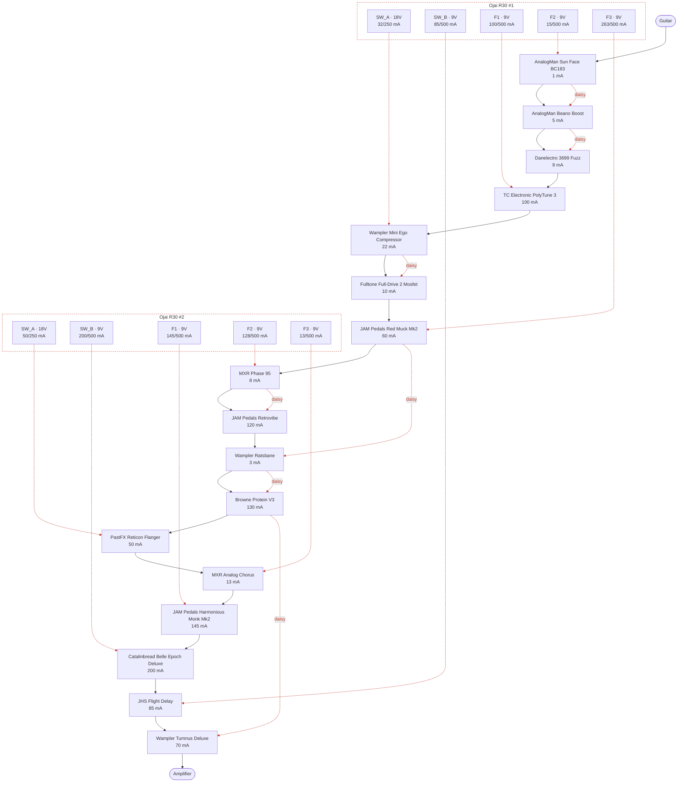

# Guitar gig board

> Generated by `scripts/build.py` from `catalog/` and this folder's `project.json`. Edit those, not this file.

- **Instrument:** guitar
- **Board:** Fender Professional (Medium) (24 x 13.06 in)
- **Validation:** OK, 0 warning(s) (`no_unknown` on)

## Signal chain

| # | Pedal | Owned | Power | Bypass | Digital | Powered from |
|--:|---|:-:|---|---|:-:|---|
| 1 | AnalogMan Sun Face BC183 | Yes | 9V, 1 mA | True | No | Ojai R30 #1 · F2 |
| 2 | AnalogMan Beano Boost | Yes | 9V, 5 mA | True | No | Ojai R30 #1 · F2 |
| 3 | Danelectro 3699 Fuzz | No | 9V, 9 mA | True | No | Ojai R30 #1 · F2 |
| 4 | TC Electronic PolyTune 3 | Yes | 9V, 100 mA | Buffered (switchable) | Yes | Ojai R30 #1 · F1 |
| 5 | Wampler Mini Ego Compressor | Yes | 18V, 22 mA | True | No | Ojai R30 #1 · SW_A |
| 6 | Fulltone Full-Drive 2 Mosfet | Yes | 18V, 10 mA | True | No | Ojai R30 #1 · SW_A |
| 7 | JAM Pedals Red Muck Mk2 | Yes | 9V, 60 mA | True | No | Ojai R30 #1 · F3 |
| 8 | MXR Phase 95 | Yes | 9V, 8 mA | True | No | Ojai R30 #2 · F2 |
| 9 | JAM Pedals Retrovibe | Yes | 9V, 120 mA | True | No | Ojai R30 #2 · F2 |
| 10 | Wampler Ratsbane | Yes | 9V, 3 mA | True | No | Ojai R30 #1 · F3 |
| 11 | Browne Protein V3 | Yes | 9V, 130 mA | True | No | Ojai R30 #1 · F3 |
| 12 | PastFX Reticon Flanger | Yes | 18V, 50 mA | True | No | Ojai R30 #2 · SW_A |
| 13 | MXR Analog Chorus | Yes | 9V, 13 mA | Buffered | No | Ojai R30 #2 · F3 |
| 14 | JAM Pedals Harmonious Monk Mk2 | Yes | 9V, 145 mA | True | Yes | Ojai R30 #2 · F1 |
| 15 | Catalinbread Belle Epoch Deluxe | Yes | 9V, 200 mA | True (switchable) | Yes | Ojai R30 #2 · SW_B |
| 16 | JHS Flight Delay | No | 9V, 85 mA | Buffered (switchable) | Yes | Ojai R30 #1 · SW_B |
| 17 | Wampler Tumnus Deluxe | Yes | 9V, 70 mA | Buffered (switchable) | No | Ojai R30 #1 · F3 |

**To buy:** Danelectro 3699 Fuzz, JHS Flight Delay

### Ordering rules

- **AnalogMan Sun Face BC183** no buffered pedal anywhere before it (priority 100): AnalogMan: the Fuzz Face must see the guitar directly; no buffered pedal ahead of it `[catalog]`
- **AnalogMan Beano Boost** no buffered pedal anywhere before it (priority 100): AnalogMan: no buffered pedal ahead of the Beano `[catalog]`
- **AnalogMan Beano Boost** must come after AnalogMan Sun Face BC183: Direct post-fuzz boost `[project]`
- **MXR Phase 95** must come before Wampler Ratsbane: Van Halen phaser-into-hard-clipping sound `[project]`
- **JAM Pedals Retrovibe** must come before Browne Protein V3, Wampler Ratsbane: Uni-Vibe feeding the dirt `[project]`
- **Browne Protein V3** must come after Wampler Ratsbane: Stacks on / smooths the Ratsbane's hard clipping `[project]`
- **PastFX Reticon Flanger** must come after all `gain` pedals: Modulation after the gain pedals `[project]`
- **MXR Analog Chorus** must come after all `gain` pedals: Modulation after the gain pedals `[project]`
- **JAM Pedals Harmonious Monk Mk2** must come after all `modulation` pedals: Tremolo after the modulation pedals `[project]`
- **Catalinbread Belle Epoch Deluxe** must come after all `gain` pedals: Original plan: time-based effects after the dirt `[project]`
- **Catalinbread Belle Epoch Deluxe** must come before JHS Flight Delay: Belle Epoch ahead of the Flight Delay `[project]`
- **Danelectro 3699 Fuzz** must come after AnalogMan Sun Face BC183, AnalogMan Beano Boost *(preferred)*: Placeholder: front fuzz group, where the Double Dragon was `[project]`
- **Wampler Tumnus Deluxe** must be last in the chain (priority 100): Final volume and EQ setting; also the end-of-chain buffer. Outranks every group-order rule, because the Tumnus is also tagged gain `[project]`
- **JHS Flight Delay** must come after all `gain` pedals: Time-based effects after the dirt `[project]`
- **TC Electronic PolyTune 3** must come after AnalogMan Sun Face BC183, AnalogMan Beano Boost, Danelectro 3699 Fuzz (priority 100): Fuzz rules win: the fuzz group comes first, with no buffer ahead of the Sun Face and Beano `[project]`
- **TC Electronic PolyTune 3** must be first in the chain (priority 50): Tuner should come first (overruled by the fuzz rules) `[project]`
- **Wampler Mini Ego Compressor** must come after AnalogMan Sun Face BC183, AnalogMan Beano Boost, Danelectro 3699 Fuzz (priority 100): Fuzz rules win: the fuzz group comes first `[project]`
- **Wampler Mini Ego Compressor** must be first in the chain (priority 10): Compressor should come first (overruled by the fuzz rules and the tuner rule) `[project]`

### Section order

Pedals in an earlier section come before pedals in a later one (priority -10); pedals not listed are only bound by the rules above.

1. **fuzz / old school**: AnalogMan Sun Face BC183, AnalogMan Beano Boost, Danelectro 3699 Fuzz
2. **drives / fuzz before the phasers (any order)**: Fulltone Full-Drive 2 Mosfet, JAM Pedals Red Muck Mk2
3. **phase-type (phaser, vibe; any order)**: MXR Phase 95, JAM Pedals Retrovibe
4. **drives / distortion after the phasers (Protein still follows Ratsbane)**: Wampler Ratsbane, Browne Protein V3
5. **modulation**: PastFX Reticon Flanger, MXR Analog Chorus
6. **tremolo**: JAM Pedals Harmonious Monk Mk2
7. **delays**: Catalinbread Belle Epoch Deluxe, JHS Flight Delay
8. **eq / boost**: Wampler Tumnus Deluxe

### Overridden by priority

- `sun_face.no_buffered_before` overrides `polytune_3.first` for: polytune_3 before sun_face
- `beano.no_buffered_before` overrides `polytune_3.first` for: polytune_3 before beano
- `tumnus_deluxe.position_last` overrides `reticon.after_group_gain` for: tumnus_deluxe before reticon
- `tumnus_deluxe.position_last` overrides `analog_chorus.after_group_gain` for: tumnus_deluxe before analog_chorus
- `tumnus_deluxe.position_last` overrides `belle_epoch.after_group_gain` for: tumnus_deluxe before belle_epoch
- `tumnus_deluxe.position_last` overrides `flight_delay.after_group_gain` for: tumnus_deluxe before flight_delay
- `polytune_3.after_fuzz` overrides `polytune_3.first` for: polytune_3 before danelectro_3699
- `polytune_3.first` overrides `mini_ego.first` for: mini_ego before polytune_3
- `mini_ego.after_fuzz` overrides `mini_ego.first` for: mini_ego before sun_face; mini_ego before beano; mini_ego before danelectro_3699

### Notes per pedal

- **AnalogMan Sun Face BC183**: Silicon Fuzz Face, unbuffered: must be FIRST in the chain, guitar straight into it. Ships battery-only; check your unit has the optional DC jack. Silicon version is negative ground so sharing power is OK, but AnalogMan warns a supply can add hum/oscillation. 'Under 1 mA' is from the shared Fuzz Face page.
- **AnalogMan Beano Boost**: Germanium treble booster, direct post-fuzz. Per AnalogMan it can share a DC supply with the Sun Face and other basic fuzzes (keep that group simple). The Oct 2020 manual text read by the research agent said isolated power only / no daisy-chaining, so confirm the wording for your unit. Never 9V AC. Needs the DC jack option (battery by default). Center-negative.
- **Danelectro 3699 Fuzz**: Fuzz/octaver, candidate to replace the JHS Double Dragon in the front fuzz group. 9 mA is from a single retailer listing (another says 3 mA; no Danelectro spec sheet found), so planning on 9 mA. Spec lists 9V DC, supply not included; a 9V battery is reported to work. Assumed 9V only. Planned for the gig board; placement after the Beano is a placeholder: confirm.
- **TC Electronic PolyTune 3**: Tuner / master front buffer. 100 mA is the manual's minimum supply rating; measured draw is lower (~38 mA reported for the Mini). Bypass mode is selectable by DIP switch (true by default, buffered, or buffered with display on); buffer ENABLED in this plan as the master front buffer. Has a power-out jack for daisy-chaining.
- **Wampler Mini Ego Compressor**: Compressor. Wampler publishes 14 mA at 9V and 22 mA at 18V (figure here is the 18V one). Page does not explicitly state the jack is 18V-rated. True bypass. Listed as 'Ego Mini' in the original plan.
- **Fulltone Full-Drive 2 Mosfet**: Overdrive, more headroom at 18V. ~10 mA is from Fulltone's page for the newer v2; no manufacturer figure found for the original Mosfet model (one forum measurement: ~7 mA).
- **JAM Pedals Red Muck Mk2**: Russian/Civil War Muff fuzz. Sources conflict: 60 mA (JAM shop page) vs 12-15 mA (retailers); planning on 60 mA until the manual is checked. True bypass.
- **MXR Phase 95**: Phaser, pre-dirt for a classic 70s sweep. No battery option. True bypass. Exempt from 'modulation after gain': intentionally ahead of the dirt.
- **JAM Pedals Retrovibe**: Photocell Uni-Vibe, pre-dirt for throbbing fuzz-vibe tones. 120 mA assumes the current mk.4 (mk.3 is listed at 80-150 mA): check your version. True bypass, no battery. Exempt from 'modulation after gain': intentionally ahead of the dirt.
- **Wampler Ratsbane**: Hard-clipping distortion. 2.5 mA at 9V, 3.2 mA at 18V; approved for 18V but designed around 9V. No battery connector. True bypass.
- **Browne Protein V3**: Dual overdrive, placed post-Ratsbane to stack or smooth the hard clipping. 9V only ('18V is not better'). Fully analog (per owner), so it may share an output. True bypass (per owner; V3 uses soft/electronic switching per Browne). This is the V3. Browne's sources conflict for V3 current: manual says <100 mA, a Browne Q&A line says 130 mA, retailers quote ~30 mA. Planning on 130 mA (worst case).
- **PastFX Reticon Flanger**: Analog BBD flanger, post-dirt modulation. Needs an isolated 18V output, no battery. True bypass (per owner). 'Under 50 mA' is from search snippets of the PastFX page/manual (direct fetch failed): verify.
- **MXR Analog Chorus**: Analog BBD chorus (M234). Buffered bypass per the Dunlop manual (one reviewer says it dulls highs when off). Battery or 9V DC.
- **JAM Pedals Harmonious Monk Mk2**: Harmonic tremolo with digital tap controller. Analog signal path but a digital processor, so treated as DIGITAL: must not share an output. JAM recommends an isolated supply; 145 mA is JAM's max (third-party listings say 35-100 mA). True bypass.
- **Catalinbread Belle Epoch Deluxe**: Tape echo emulation. Analog EP-3-style circuitry around a 24-bit digital delay line, so treated as DIGITAL. Catalinbread lists 9V DC ONLY at 200 mA (it steps up to an internal rail itself): the original plan had it on 18V, which could damage it, so it is on a 9V output here. Give it a clean isolated output. Spelled 'Epoque' in the original plan.
- **JHS Flight Delay**: Delay with analog-style (BBD voiced) and DSP-style digital modes, so treated as DIGITAL (circuit not confirmed). Planned for the gig board (after the Belle Epoch, to buy) (not in your Pedal Playground save, so marked not owned). 85 mA at 9V DC center-negative per retailers; JHS warns against going above 9V. Bypass is switchable between true bypass and buffered (per owner); buffered in this plan. Also has a Trails bypass mode.
- **Wampler Tumnus Deluxe**: Klon-style EQ/overdrive: dead last, master mid-stack and buffer. Runs at 9V ONLY (boosts the rail internally, do not use 18V). Buffered or true bypass via side switch (buffer enabled in this plan). 70.3 mA at 9V. Tagged 'gain' (it is a drive) but 'dead last' outranks the group-order rules via priority.

## Powering

Draw figures are the worst-case values in `catalog/pedals.json`. Pedals are daisy-chained by **effect type**, not by chain order: time-based/clocked effects (BBD or digital) never share an output with compressors or gain pedals, a **digital** pedal (including one with a digital processor in an analog path) always has an output to itself, and 18V-capable pedals share 18V outputs. The build checks all three (policy in `project.json`: `power_policy`).

### Ojai R30 #1

| Output | Voltage | Pedal | Draw (mA) | Output total |
|---|--:|---|--:|--:|
| **SW_A** (switchable) | 18V | Wampler Mini Ego Compressor | 22 | 32 / 250 mA |
|  | 18V | Fulltone Full-Drive 2 Mosfet | 10 |  |
| **SW_B** (switchable) | 9V | JHS Flight Delay | 85 | 85 / 500 mA |
| **F1** (fixed) | 9V | TC Electronic PolyTune 3 | 100 | 100 / 500 mA |
| **F2** (fixed) | 9V | AnalogMan Sun Face BC183 | 1 | 15 / 500 mA |
|  | 9V | AnalogMan Beano Boost | 5 |  |
|  | 9V | Danelectro 3699 Fuzz | 9 |  |
| **F3** (fixed) | 9V | JAM Pedals Red Muck Mk2 | 60 | 263 / 500 mA |
|  | 9V | Wampler Ratsbane | 3 |  |
|  | 9V | Browne Protein V3 | 130 |  |
|  | 9V | Wampler Tumnus Deluxe | 70 |  |
| | | **Ojai R30 #1 total** | | **495 mA** |

### Ojai R30 #2

| Output | Voltage | Pedal | Draw (mA) | Output total |
|---|--:|---|--:|--:|
| **SW_A** (switchable) | 18V | PastFX Reticon Flanger | 50 | 50 / 250 mA |
| **SW_B** (switchable) | 9V | Catalinbread Belle Epoch Deluxe | 200 | 200 / 500 mA |
| **F1** (fixed) | 9V | JAM Pedals Harmonious Monk Mk2 | 145 | 145 / 500 mA |
| **F2** (fixed) | 9V | MXR Phase 95 | 8 | 128 / 500 mA |
|  | 9V | JAM Pedals Retrovibe | 120 |  |
| **F3** (fixed) | 9V | MXR Analog Chorus | 13 | 13 / 500 mA |
| | | **Ojai R30 #2 total** | | **536 mA** |

**All supplies combined:** 1031 mA

