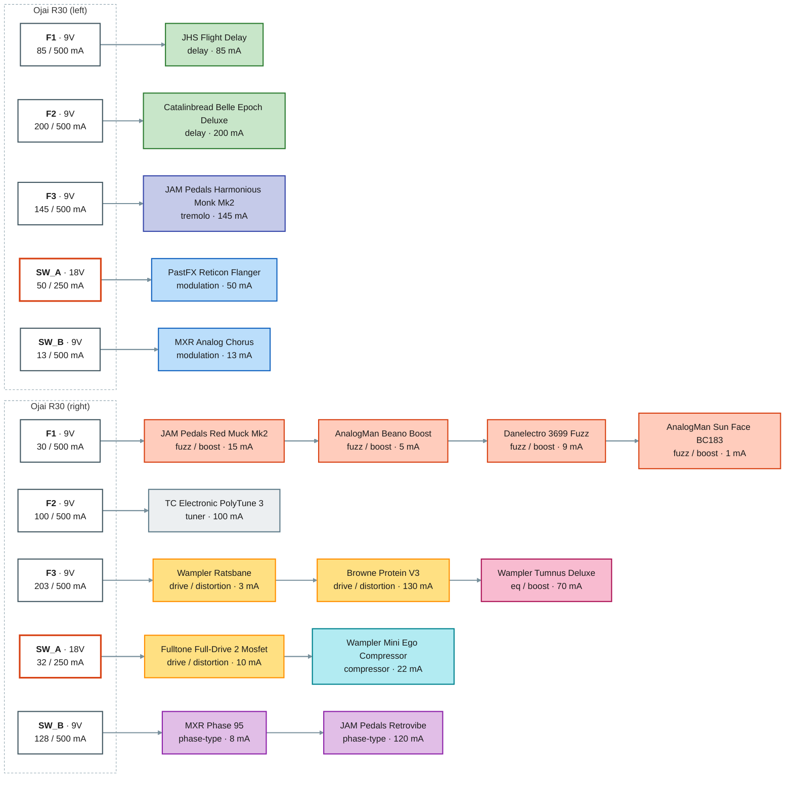
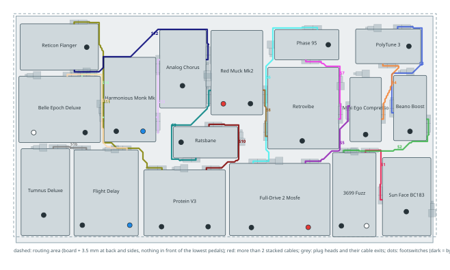
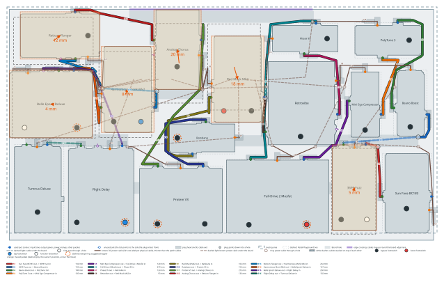
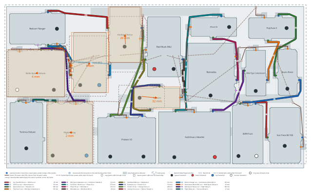
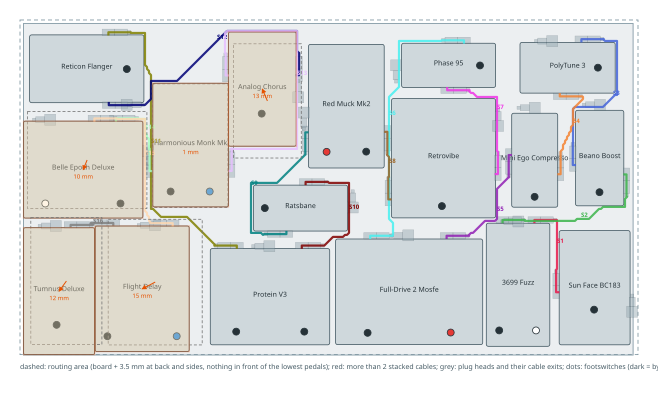

# Guitar gig board

> Generated by `scripts/build.py` from `catalog/` and this folder's `project.json`. Edit those, not this file.

- **Instrument:** guitar
- **Board:** Fender Professional (Medium) (610 x 332 mm)
- **Validation:** OK, 4 warning(s) (`no_unknown` on)

<details><summary>Validation messages</summary>

- WARN clearance: monk.out (Output, facing left, ernie_ball_flat_patch_ra right-angle plug, cable exits right) is blocked by Catalinbread Belle Epoch Deluxe (Black Edition): it reaches 12.7 mm into the plug's barrel
- WARN clearance: red_muck.power (Power, facing left, dc_ra_2_1_low_profile right-angle plug, cable exits left) is blocked by MXR Analog Chorus: it reaches 3.0 mm into the plug's head
- WARN clearance: monk.power (Power, facing left, dc_ra_2_1_low_profile right-angle plug, cable exits left) is blocked by Catalinbread Belle Epoch Deluxe (Black Edition): it reaches 9.0 mm into the plug's barrel
- WARN footswitches: no footswitch data for 8 of 17 pedals (retrovibe, red_muck, protein, analog_chorus, monk, belle_epoch, flight_delay, tumnus_deluxe) -> run: uv run scripts/pedal_editor.py --list-missing guitar-gig --only footswitches

</details>

## Signal chain

```mermaid
flowchart TB
    guitar(["Guitar"]):::endpoint
    sun_face["<b>1</b> &nbsp;AnalogMan Sun Face BC183<br/>fuzz / boost"]:::c_fuzz___boost
    danelectro_3699["<b>2</b> &nbsp;Danelectro 3699 Fuzz<br/>fuzz / boost"]:::c_fuzz___boost
    beano["<b>3</b> &nbsp;AnalogMan Beano Boost<br/>fuzz / boost"]:::c_fuzz___boost
    polytune_3["<b>4</b> &nbsp;TC Electronic PolyTune 3<br/>tuner"]:::c_tuner
    mini_ego["<b>5</b> &nbsp;Wampler Mini Ego Compressor<br/>compressor"]:::c_compressor
    fulldrive_2["<b>6</b> &nbsp;Fulltone Full-Drive 2 Mosfet<br/>drive / distortion"]:::c_drive___distortion
    phase_95["<b>7</b> &nbsp;MXR Phase 95<br/>phase-type"]:::c_phase_type
    retrovibe["<b>8</b> &nbsp;JAM Pedals Retrovibe<br/>phase-type"]:::c_phase_type
    red_muck["<b>9</b> &nbsp;JAM Pedals Red Muck Mk2<br/>fuzz / boost"]:::c_fuzz___boost
    ratsbane["<b>10</b> &nbsp;Wampler Ratsbane<br/>drive / distortion"]:::c_drive___distortion
    protein["<b>11</b> &nbsp;Browne Protein V3<br/>drive / distortion"]:::c_drive___distortion
    reticon["<b>12</b> &nbsp;PastFX Reticon Flanger<br/>modulation"]:::c_modulation
    analog_chorus["<b>13</b> &nbsp;MXR Analog Chorus<br/>modulation"]:::c_modulation
    monk["<b>14</b> &nbsp;JAM Pedals Harmonious Monk Mk2<br/>tremolo"]:::c_tremolo
    belle_epoch["<b>15</b> &nbsp;Catalinbread Belle Epoch Deluxe<br/>delay"]:::c_delay
    flight_delay["<b>16</b> &nbsp;JHS Flight Delay<br/>delay"]:::c_delay
    tumnus_deluxe["<b>17</b> &nbsp;Wampler Tumnus Deluxe<br/>eq / boost"]:::c_eq___boost
    amp(["Amplifier"]):::endpoint
    guitar --> sun_face --> danelectro_3699 --> beano --> polytune_3 --> mini_ego --> fulldrive_2 --> phase_95 --> retrovibe --> red_muck --> ratsbane --> protein --> reticon --> analog_chorus --> monk --> belle_epoch --> flight_delay --> tumnus_deluxe --> amp
    classDef endpoint fill:#263238,stroke:#263238,color:#ffffff
    classDef c_tuner fill:#eceff1,stroke:#607d8b,stroke-width:2px,color:#1b1b1b
    classDef c_compressor fill:#b2ebf2,stroke:#00838f,stroke-width:2px,color:#1b1b1b
    classDef c_fuzz___boost fill:#ffccbc,stroke:#d84315,stroke-width:2px,color:#1b1b1b
    classDef c_drive___distortion fill:#ffe082,stroke:#ff8f00,stroke-width:2px,color:#1b1b1b
    classDef c_phase_type fill:#e1bee7,stroke:#8e24aa,stroke-width:2px,color:#1b1b1b
    classDef c_modulation fill:#bbdefb,stroke:#1565c0,stroke-width:2px,color:#1b1b1b
    classDef c_tremolo fill:#c5cae9,stroke:#3949ab,stroke-width:2px,color:#1b1b1b
    classDef c_delay fill:#c8e6c9,stroke:#2e7d32,stroke-width:2px,color:#1b1b1b
    classDef c_eq___boost fill:#f8bbd0,stroke:#ad1457,stroke-width:2px,color:#1b1b1b
    linkStyle default stroke:#78909c,stroke-width:2px
```



| # | Pedal | Owned | Accepts | Runs at | Draw | Bypass | Digital | Powered from |
|--:|---|:-:|---|---|--:|---|:-:|---|
| 1 | AnalogMan Sun Face BC183 | Yes | 9V | 9V | 1 mA | True | No | Ojai R30 · F1 |
| 2 | Danelectro 3699 Fuzz | No | 9V | 9V | 9 mA | True | No | Ojai R30 · F1 |
| 3 | AnalogMan Beano Boost | Yes | 9V | 9V | 5 mA | True | No | Ojai R30 · F1 |
| 4 | TC Electronic PolyTune 3 | Yes | 9V | 9V | 100 mA | Buffered (switchable) | Yes | Ojai R30 · F2 |
| 5 | Wampler Mini Ego Compressor | Yes | 9-18V | 18V | 22 mA | True | No | Ojai R30 · SW_A |
| 6 | Fulltone Full-Drive 2 Mosfet | Yes | 9-18V | 18V | 10 mA | True | No | Ojai R30 · SW_A |
| 7 | MXR Phase 95 | Yes | 9V | 9V | 8 mA | True | No | Ojai R30 · SW_B |
| 8 | JAM Pedals Retrovibe | Yes | 9V | 9V | 120 mA | True | No | Ojai R30 · SW_B |
| 9 | JAM Pedals Red Muck Mk2 | Yes | 9V | 9V | 15 mA | True | No | Ojai R30 · F1 |
| 10 | Wampler Ratsbane | Yes | 9-18V | 9V | 3 mA | True | No | Ojai R30 · F3 |
| 11 | Browne Protein V3 | Yes | 9V | 9V | 130 mA | True | No | Ojai R30 · F3 |
| 12 | PastFX Reticon Flanger | Yes | 18V | 18V | 50 mA | True | No | Ojai R30 · SW_A |
| 13 | MXR Analog Chorus | Yes | 9V | 9V | 13 mA | Buffered | No | Ojai R30 · SW_B |
| 14 | JAM Pedals Harmonious Monk Mk2 | Yes | 9V | 9V | 145 mA | True | Yes | Ojai R30 · F3 |
| 15 | Catalinbread Belle Epoch Deluxe | Yes | 9V | 9V | 200 mA | True (switchable) | Yes | Ojai R30 · F2 |
| 16 | JHS Flight Delay | No | 9V | 9V | 85 mA | Buffered (switchable) | Yes | Ojai R30 · F1 |
| 17 | Wampler Tumnus Deluxe | Yes | 9V | 9V | 70 mA | Buffered (switchable) | No | Ojai R30 · F3 |

**To buy:** Danelectro 3699 Fuzz, JHS Flight Delay

### Ordering rules

- **AnalogMan Sun Face BC183** no buffered pedal anywhere before it (priority 100): AnalogMan: the Fuzz Face must see the guitar directly; no buffered pedal ahead of it `[catalog]`
- **AnalogMan Beano Boost** no buffered pedal anywhere before it (priority 100): AnalogMan: no buffered pedal ahead of the Beano `[catalog]`
- **AnalogMan Beano Boost** must come after AnalogMan Sun Face BC183: Direct post-fuzz boost `[project]`
- **MXR Phase 95** must come before Wampler Ratsbane: Van Halen phaser-into-hard-clipping sound `[project]`
- **JAM Pedals Retrovibe** must come before Browne Protein V3, Wampler Ratsbane: Uni-Vibe feeding the dirt `[project]`
- **Browne Protein V3** must come after Wampler Ratsbane: Stacks on / smooths the Ratsbane's hard clipping `[project]`
- **PastFX Reticon Flanger** must come after all `gain` pedals: Modulation after the gain pedals `[project]`
- **MXR Analog Chorus** must come after all `gain` pedals: Modulation after the gain pedals `[project]`
- **JAM Pedals Harmonious Monk Mk2** must come after all `modulation` pedals: Tremolo after the modulation pedals `[project]`
- **Catalinbread Belle Epoch Deluxe** must come after all `gain` pedals: Original plan: time-based effects after the dirt `[project]`
- **Catalinbread Belle Epoch Deluxe** must come before JHS Flight Delay: Belle Epoch ahead of the Flight Delay `[project]`
- **Wampler Tumnus Deluxe** must be last in the chain (priority 100): Final volume and EQ setting; also the end-of-chain buffer. Outranks every group-order rule, because the Tumnus is also tagged gain `[project]`
- **JHS Flight Delay** must come after all `gain` pedals: Time-based effects after the dirt `[project]`
- **TC Electronic PolyTune 3** must come after AnalogMan Sun Face BC183, AnalogMan Beano Boost, Danelectro 3699 Fuzz (priority 100): Fuzz rules win: the fuzz group comes first, with no buffer ahead of the Sun Face and Beano `[project]`
- **TC Electronic PolyTune 3** must be first in the chain (priority 50): Tuner should come first (overruled by the fuzz rules) `[project]`
- **Wampler Mini Ego Compressor** must come after AnalogMan Sun Face BC183, AnalogMan Beano Boost, Danelectro 3699 Fuzz (priority 100): Fuzz rules win: the fuzz group comes first `[project]`
- **Wampler Mini Ego Compressor** must be first in the chain (priority 10): Compressor should come first (overruled by the fuzz rules and the tuner rule) `[project]`
- **MXR Phase 95** must come before JAM Pedals Red Muck Mk2: Phaser into the Muff fuzz for Pink Floyd sounds `[project]`
- **JAM Pedals Retrovibe** must come before JAM Pedals Red Muck Mk2: Vibe into the Muff fuzz for Pink Floyd sounds `[project]`
- **Fulltone Full-Drive 2 Mosfet** must come before MXR Phase 95, JAM Pedals Retrovibe: Full-Drive stays ahead of the phaser and vibe `[project]`
- **Danelectro 3699 Fuzz** must come after AnalogMan Sun Face BC183 *(preferred)*: Fuzz Face first; the Danelectro follows it `[project]`
- **Danelectro 3699 Fuzz** must come before AnalogMan Beano Boost: True bypass, so it can sit ahead of the Beano `[project]`

### Section order

Pedals in an earlier section come before pedals in a later one (priority -10); pedals not listed are only bound by the rules above.

1. **fuzz / old school**: AnalogMan Sun Face BC183, AnalogMan Beano Boost, Danelectro 3699 Fuzz
2. **drive before the phasers**: Fulltone Full-Drive 2 Mosfet
3. **phase-type (phaser, vibe; any order)**: MXR Phase 95, JAM Pedals Retrovibe
4. **fuzz / distortion after the phasers (Protein still follows Ratsbane)**: JAM Pedals Red Muck Mk2, Wampler Ratsbane, Browne Protein V3
5. **modulation**: PastFX Reticon Flanger, MXR Analog Chorus
6. **tremolo**: JAM Pedals Harmonious Monk Mk2
7. **delays**: Catalinbread Belle Epoch Deluxe, JHS Flight Delay
8. **eq / boost**: Wampler Tumnus Deluxe

### Overridden by priority

- `sun_face.no_buffered_before` overrides `polytune_3.first` for: polytune_3 before sun_face
- `beano.no_buffered_before` overrides `polytune_3.first` for: polytune_3 before beano
- `tumnus_deluxe.position_last` overrides `reticon.after_group_gain` for: tumnus_deluxe before reticon
- `tumnus_deluxe.position_last` overrides `analog_chorus.after_group_gain` for: tumnus_deluxe before analog_chorus
- `tumnus_deluxe.position_last` overrides `belle_epoch.after_group_gain` for: tumnus_deluxe before belle_epoch
- `tumnus_deluxe.position_last` overrides `flight_delay.after_group_gain` for: tumnus_deluxe before flight_delay
- `polytune_3.after_fuzz` overrides `polytune_3.first` for: polytune_3 before danelectro_3699
- `polytune_3.first` overrides `mini_ego.first` for: mini_ego before polytune_3
- `mini_ego.after_fuzz` overrides `mini_ego.first` for: mini_ego before sun_face; mini_ego before beano; mini_ego before danelectro_3699

### Notes per pedal

- **AnalogMan Sun Face BC183**: Silicon Fuzz Face, unbuffered: must be FIRST in the chain, guitar straight into it. Ships battery-only; check your unit has the optional DC jack. Silicon version is negative ground so sharing power is OK, but AnalogMan warns a supply can add hum/oscillation. 'Under 1 mA' is from the shared Fuzz Face page. Power re-checked 2026-10-21: no source publishes a current draw, so 1 mA is unverified; AnalogMan never forbids higher than 9V but gives no range either.
- **Danelectro 3699 Fuzz**: Fuzz/octaver, candidate to replace the JHS Double Dragon in the front fuzz group. 9 mA is from a single retailer listing (another says 3 mA; no Danelectro spec sheet found), so planning on 9 mA. Spec lists 9V DC, supply not included; a 9V battery is reported to work. Assumed 9V only. Planned for the gig board, between the Sun Face and the Beano. True bypass per retailer spec lists (no Danelectro spec sheet found).
- **AnalogMan Beano Boost**: Germanium treble booster, direct post-fuzz. Per AnalogMan it can share a DC supply with the Sun Face and other basic fuzzes (keep that group simple). The Oct 2020 manual text read by the research agent said isolated power only / no daisy-chaining, so confirm the wording for your unit. Never 9V AC. Needs the DC jack option (battery by default). Center-negative.
- **TC Electronic PolyTune 3**: Tuner / master front buffer. 100 mA is the manual's minimum supply rating; measured draw is lower (~38 mA reported for the Mini). Bypass mode is selectable by DIP switch (true by default, buffered, or buffered with display on); buffer ENABLED in this plan as the master front buffer. Has a power-out jack for daisy-chaining. Power re-checked 2026-10-21: actual draw 45 mA (full size) / 40 mA (Mini), but TC asks for a >100 mA supply and one Noir listing says 100 mA, so 100 mA stays as the worst case.
- **Wampler Mini Ego Compressor**: Compressor. Wampler publishes 14 mA at 9V and 22 mA at 18V (figure here is the 18V one). Page does not explicitly state the jack is 18V-rated. True bypass. Listed as 'Ego Mini' in the original plan.
- **Fulltone Full-Drive 2 Mosfet**: Overdrive, more headroom at 18V. ~10 mA is from Fulltone's page for the newer v2; no manufacturer figure found for the original Mosfet model (one forum measurement: ~7 mA).
- **MXR Phase 95**: Phaser, pre-dirt for a classic 70s sweep. No battery option. True bypass. Exempt from 'modulation after gain': intentionally ahead of the dirt.
- **JAM Pedals Retrovibe**: Photocell Uni-Vibe, pre-dirt for throbbing fuzz-vibe tones. 120 mA assumes the current mk.4 (mk.3 is listed at 80-150 mA): check your version. True bypass, no battery. Exempt from 'modulation after gain': intentionally ahead of the dirt.
- **JAM Pedals Red Muck Mk2**: Russian/Civil War Muff fuzz. Sources conflict: 60 mA (JAM shop page) vs 12-15 mA (retailers); planning on 60 mA until the manual is checked. True bypass. Power re-checked 2026-10-21: 12 mA on most listings, 15 mA on Thomann (planning on 15); the old 60 mA appears in no source.
- **Wampler Ratsbane**: Hard-clipping distortion. 2.5 mA at 9V, 3.2 mA at 18V; approved for 18V but designed around 9V. No battery connector. True bypass.
- **Browne Protein V3**: Dual overdrive, placed post-Ratsbane to stack or smooth the hard clipping. 9V only ('18V is not better'). Fully analog (per owner), so it may share an output. True bypass (per owner; V3 uses soft/electronic switching per Browne). This is the V3. Browne's sources conflict for V3 current: manual says <100 mA, a Browne Q&A line says 130 mA, retailers quote ~30 mA. Planning on 130 mA (worst case).
- **PastFX Reticon Flanger**: Analog BBD flanger, post-dirt modulation. Needs an isolated 18V output, no battery. True bypass (per owner). 'Under 50 mA' is from search snippets of the PastFX page/manual (direct fetch failed): verify.
- **MXR Analog Chorus**: Analog BBD chorus (M234). Buffered bypass per the Dunlop manual (one reviewer says it dulls highs when off). Battery or 9V DC.
- **JAM Pedals Harmonious Monk Mk2**: Harmonic tremolo with digital tap controller. Analog signal path but a digital processor, so treated as DIGITAL: must not share an output. JAM recommends an isolated supply; 145 mA is JAM's max (third-party listings say 35-100 mA). True bypass.
- **Catalinbread Belle Epoch Deluxe**: Tape echo emulation. Analog EP-3-style circuitry around a 24-bit digital delay line, so treated as DIGITAL. Catalinbread lists 9V DC ONLY at 200 mA (it steps up to an internal rail itself): the original plan had it on 18V, which could damage it, so it is on a 9V output here. Give it a clean isolated output. Spelled 'Epoque' in the original plan.
- **JHS Flight Delay**: Delay with analog-style (BBD voiced) and DSP-style digital modes, so treated as DIGITAL (circuit not confirmed). Planned for the gig board (after the Belle Epoch, to buy) (not in your Pedal Playground save, so marked not owned). 85 mA at 9V DC center-negative per retailers; JHS warns against going above 9V. Bypass is switchable between true bypass and buffered (per owner); buffered in this plan. Also has a Trails bypass mode.
- **Wampler Tumnus Deluxe**: Klon-style EQ/overdrive: dead last, master mid-stack and buffer. Runs at 9V ONLY (boosts the rail internally, do not use 18V). Buffered or true bypass via side switch (buffer enabled in this plan). 70.3 mA at 9V. Tagged 'gain' (it is a drive) but 'dead last' outranks the group-order rules via priority.

## Powering

Every output and the pedals daisy-chained on it, grouped for power (not in signal order); colors are the effect categories, a red border marks an 18V output.



Draw figures are the worst-case values in `catalog/pedals.json`. Pedals are daisy-chained by **effect type**, not by chain order: time-based/clocked effects (BBD or digital) never share an output with compressors or gain pedals, a **digital** pedal (including one with a digital processor in an analog path) always has an output to itself, and 18V-capable pedals share 18V outputs. The build checks all three (policy in `project.json`: `power_policy`).

### Ojai R30 (left)

| Output | Voltage | Pedal | Draw (mA) | Output total |
|---|--:|---|--:|--:|
| **F1** (fixed) | 9V | JHS Flight Delay | 85 | 85 / 500 mA |
| **F2** (fixed) | 9V | Catalinbread Belle Epoch Deluxe | 200 | 200 / 500 mA |
| **F3** (fixed) | 9V | JAM Pedals Harmonious Monk Mk2 | 145 | 145 / 500 mA |
| **SW_A** (switchable) | 18V | PastFX Reticon Flanger | 50 | 50 / 250 mA |
| **SW_B** (switchable) | 9V | MXR Analog Chorus | 13 | 13 / 500 mA |
| | | **Ojai R30 total** | | **493 mA** |

### Ojai R30 (right)

| Output | Voltage | Pedal | Draw (mA) | Output total |
|---|--:|---|--:|--:|
| **F1** (fixed) | 9V | JAM Pedals Red Muck Mk2 | 15 | 30 / 500 mA |
|  | 9V | AnalogMan Beano Boost | 5 |  |
|  | 9V | Danelectro 3699 Fuzz | 9 |  |
|  | 9V | AnalogMan Sun Face BC183 | 1 |  |
| **F2** (fixed) | 9V | TC Electronic PolyTune 3 | 100 | 100 / 500 mA |
| **F3** (fixed) | 9V | Wampler Ratsbane | 3 | 203 / 500 mA |
|  | 9V | Browne Protein V3 | 130 |  |
|  | 9V | Wampler Tumnus Deluxe | 70 |  |
| **SW_A** (switchable) | 18V | Fulltone Full-Drive 2 Mosfet | 10 | 32 / 250 mA |
|  | 18V | Wampler Mini Ego Compressor | 22 |  |
| **SW_B** (switchable) | 9V | MXR Phase 95 | 8 | 128 / 500 mA |
|  | 9V | JAM Pedals Retrovibe | 120 |  |
| | | **Ojai R30 total** | | **493 mA** |

**All supplies combined:** 986 mA


## Jacks and cables

Jack data: 18 of 18 catalog items set up (pedals and supplies in this project).

Blocked cable space (signal jacks with a cable type: the plug head plus its cable exit on the side the router chose (see Cable routing); power jacks: the DC plug head plus its cable exit on the less blocked side; other jacks: 6.3 mm outward, 7 mm to each side):

- `monk.out` is blocked by Catalinbread Belle Epoch Deluxe (Black Edition): 12.7 mm into the barrel of the ernie_ball_flat_patch_ra plug, cable exits right
- `red_muck.power` is blocked by MXR Analog Chorus: 3.0 mm into the head of the dc_ra_2_1_low_profile plug, cable exits left
- `monk.power` is blocked by Catalinbread Belle Epoch Deluxe (Black Edition): 9.0 mm into the barrel of the dc_ra_2_1_low_profile plug, cable exits left

Cable lengths: see Cable routing.


## Cable routing

Signal cables are routed on the board surface between the pedals: never under the board, never in front of the lowest pedals, at most 3.5 mm beyond the back and sides, at most 2 cables stacked in one 2 mm cell (cable width on the board 3.5 mm). Plugs are modelled (default cable type `ernie_ball_flat_patch_ra`, catalog/cables.json): a right-angle plug's cable leaves the head to the left or right of the jack's facing (chosen per end: fewest blocked plugs, then the shortest route), runs 3.5 mm straight, then is routed; grey boxes in the picture are the plug heads and their cable exits. Power cables run under the board and are listed, not routed yet; their plug at each pedal's power jack is modelled for clearance (`dc_ra_2_1_low_profile`, exit side in the Exits column).



Min length = the shortest cable that reaches: measured from a point on each jack's axis half the clearance depth in front of the jack (half the plug head depth), along the plug's cable exit and the routed path. No slack or rounding is added. '~' marks a power cable: a right-angle estimate between its jacks (power cables are not routed).

| Cable | Kind | From | To | Type | Exits | Tips | Polarity | Under board | Min length (mm) | Status |
|---|---|---|---|---|---|---|---|:-:|--:|---|
| S1 | signal | sun_face.out | danelectro_3699.in | ernie_ball_flat_patch_ra | right / right | TS / TS | - | no | 95 | routed |
| S2 | signal | danelectro_3699.out | beano.in | ernie_ball_flat_patch_ra | right / right | TS / TS | - | no | 163 | routed |
| S3 | signal | beano.out | polytune_3.in | ernie_ball_flat_patch_ra | right / right | TS / TS | - | no | 199 | routed |
| S4 | signal | polytune_3.out | mini_ego.in | ernie_ball_flat_patch_ra | left / left | TS / TS | - | no | 110 | routed |
| S5 | signal | mini_ego.out | fulldrive_2.in | ernie_ball_flat_patch_ra | left / right | TS / TS | - | no | 128 | routed |
| S6 | signal | fulldrive_2.out | phase_95.in | ernie_ball_flat_patch_ra | right / left | TS / TS | - | no | 289 | routed |
| S7 | signal | phase_95.out | retrovibe.in | ernie_ball_flat_patch_ra | left / left | TS / TS | - | no | 132 | routed |
| S8 | signal | retrovibe.out | red_muck.in | ernie_ball_flat_patch_ra | right / right | TS / TS | - | no | 69 | routed |
| S9 | signal | red_muck.out | ratsbane.in | ernie_ball_flat_patch_ra | left / right | TS / TS | - | no | 176 | routed |
| S10 | signal | ratsbane.out | protein.in | ernie_ball_flat_patch_ra | right / right | TS / TS | - | no | 146 | routed |
| S11 | signal | protein.out | reticon.in | ernie_ball_flat_patch_ra | left / right | TS / TS | - | no | 327 | routed |
| S12 | signal | reticon.out | analog_chorus.in | ernie_ball_flat_patch_ra | left / left | TS / TS | - | no | 276 | routed |
| S13 | signal | analog_chorus.out | monk.in | ernie_ball_flat_patch_ra | left / right | TS / TS | - | no | 133 | routed |
| S14 | signal | monk.out | belle_epoch.in | ernie_ball_flat_patch_ra | right / right | TS / TS | - | no | 92 | routed |
| S15 | signal | belle_epoch.out | flight_delay.in | ernie_ball_flat_patch_ra | right / left | TS / TS | - | no | 190 | routed |
| S16 | signal | flight_delay.out | tumnus_deluxe.in | ernie_ball_flat_patch_ra | left / right | TS / TS | - | no | 51 | routed |
| P1 | power | psu1.F1 | flight_delay.power | dc_ra_2_1_low_profile | - / left | DC 2.1 mm / DC 2.1 mm | center_negative | yes | ~129 | not routed (under the board) |
| P2 | power | psu1.F2 | belle_epoch.power | dc_ra_2_1_low_profile | - / left | DC 2.1 mm / DC 2.1 mm | center_negative | yes | ~173 | not routed (under the board) |
| P3 | power | psu1.F3 | monk.power | dc_ra_2_1_low_profile | - / left | DC 2.1 mm / DC 2.1 mm | center_negative | yes | ~107 | not routed (under the board) |
| P4 | power | psu1.SW_A | reticon.power | dc_ra_2_1_low_profile | - / left | DC 2.1 mm / DC 2.1 mm | center_negative | yes | ~130 | not routed (under the board) |
| P5 | power | psu1.SW_B | analog_chorus.power | dc_ra_2_1_low_profile | - / left | DC 2.1 mm / DC 2.1 mm | center_negative | yes | ~61 | not routed (under the board) |
| P6 | power | psu2.F1 | red_muck.power | dc_ra_2_1_low_profile | - / left | DC 2.1 mm / DC 2.1 mm | center_negative | yes | ~48 | not routed (under the board) |
| P7 | power | red_muck.power | beano.power | dc_ra_2_1_low_profile | - / left | DC 2.1 mm / DC 2.1 mm | center_negative | yes | ~304 | not routed (under the board) |
| P8 | power | beano.power | danelectro_3699.power | dc_ra_2_1_low_profile | - / left | DC 2.1 mm / DC 2.1 mm | center_negative | yes | ~198 | not routed (under the board) |
| P9 | power | danelectro_3699.power | sun_face.power | dc_ra_2_1_low_profile | - / left | DC 2.1 mm / DC 2.1 mm | center_negative | yes | ~204 | not routed (under the board) |
| P10 | power | psu2.F2 | polytune_3.power | dc_ra_2_1_low_profile | - / left | DC 2.1 mm / DC 2.1 mm | center_negative | yes | ~283 | not routed (under the board) |
| P11 | power | psu2.F3 | ratsbane.power | dc_ra_2_1_low_profile | - / left | DC 2.1 mm / DC 2.1 mm | center_negative | yes | ~95 | not routed (under the board) |
| P12 | power | ratsbane.power | protein.power | dc_ra_2_1_low_profile | - / left | DC 2.1 mm / DC 2.1 mm | center_negative | yes | ~122 | not routed (under the board) |
| P13 | power | protein.power | tumnus_deluxe.power | dc_ra_2_1_low_profile | - / left | DC 2.1 mm / DC 2.1 mm | center_negative | yes | ~237 | not routed (under the board) |
| P14 | power | psu2.SW_A | fulldrive_2.power | dc_ra_2_1_low_profile | - / left | DC 2.1 mm / DC 2.1 mm | center_negative | yes | ~143 | not routed (under the board) |
| P15 | power | fulldrive_2.power | mini_ego.power | dc_ra_2_1_low_profile | - / left | DC 2.1 mm / DC 2.1 mm | center_negative | yes | ~254 | not routed (under the board) |
| P16 | power | psu2.SW_B | phase_95.power | dc_ra_2_1_low_profile | - / left | DC 2.1 mm / DC 2.1 mm | center_negative | yes | ~59 | not routed (under the board) |
| P17 | power | phase_95.power | retrovibe.power | dc_ra_2_1_low_profile | - / left | DC 2.1 mm / DC 2.1 mm | center_negative | yes | ~163 | not routed (under the board) |

Signal cable, minimum: 2576 mm over 16 cables.

## Footswitches

Footswitch data: 9 of 17 pedals (catalog/footswitches.json).

Missing (place the switches on the pedal image, then rebuild):

```
uv run scripts/pedal_editor.py retrovibe --footswitches
uv run scripts/pedal_editor.py red_muck --footswitches
uv run scripts/pedal_editor.py protein --footswitches
uv run scripts/pedal_editor.py analog_chorus --footswitches
uv run scripts/pedal_editor.py monk --footswitches
uv run scripts/pedal_editor.py belle_epoch --footswitches
uv run scripts/pedal_editor.py flight_delay --footswitches
uv run scripts/pedal_editor.py tumnus_deluxe --footswitches
```

Minimum distance between switches of different pedals (centre to centre): auto = 48.5 mm, the smallest distance between switches of different pedals in playground_design.json (the owner's layout is the reference). Switches on the same pedal are not checked. Type: bypass (turns the pedal, or one side of it, on and off), tap (tap tempo), boost (a boost / extra-gain stomp), function (any other switch).

Closest pairs (8 of 53):

| Switch | Type | Switch | Type | Distance (mm) | Status |
|---|---|---|---|--:|---|
| danelectro_3699.bypass | bypass | fulldrive_2.switch_2 | boost | 48.5 | ok |
| sun_face.bypass | bypass | danelectro_3699.switch_2 | function | 61.7 | ok |
| beano.bypass | bypass | mini_ego.bypass | bypass | 65.2 | ok |
| danelectro_3699.switch_2 | function | fulldrive_2.switch_2 | boost | 85.3 | ok |
| sun_face.bypass | bypass | danelectro_3699.bypass | bypass | 97.2 | ok |
| sun_face.bypass | bypass | beano.bypass | bypass | 117.6 | ok |
| polytune_3.bypass | bypass | phase_95.bypass | bypass | 117.9 | ok |
| beano.bypass | bypass | polytune_3.bypass | bypass | 124.7 | ok |

No pair is closer than the minimum.


## Layout proposals

Made by `python3 scripts/propose_layout.py guitar-gig --max-change fix --seed 1` (max_change `fix`, max move 40 mm, seed 1, 2000 iterations x 6 restarts, 14.3 s). Each proposal is a Pedal Playground file (Load from File: the owner's layout with only the moved pedals changed); load it, adjust, save it as playground_design.json, then build. Approximation: plug sizes are partly estimates and the search scores a simplified model; every proposal was checked with this build (clearance, routed cables, footswitch spacing).

| | Owner's layout | Proposal 1 | Proposal 2 | Proposal 3 |
|---|--:|--:|--:|--:|
| Blocked plugs | 3 (24.7 mm) | 0 (0.0 mm) | 0 (0.0 mm) | 0 (0.0 mm) |
| Unroutable / squeezed / over the stacking limit | 0 / 0 / 0 | 0 / 0 / 0 | 0 / 0 / 0 | 0 / 0 / 0 |
| Footswitch pairs below the minimum | no data | no data | no data | no data |
| Closest footswitch pair (mm) | - | - | - | - |
| Signal cables, routed minimum (mm) | 2576 | 2453 | 2744 | 2775 |
| Power cables, estimate (mm) | 2710 | 2467 | 2506 | 2521 |
| First input / last output to the board edges (mm) | 28 | 28 | 21 | 28 |
| Build errors / warnings | 0 / 4 | 0 / 1 | 0 / 1 | 0 / 1 |
| Score (lower is better) | 4068 | 3225 | 3479 | 3501 |

### Proposal 1

Pedal Playground file: [proposals/1.json](proposals/1.json); blocked plugs fixed: `monk.out`, `monk.power`, `red_muck.power`.



| Pedal | dx (mm) | dy (mm) | Moved (mm) | Rotation |
|---|--:|--:|--:|---|
| JAM Pedals Retrovibe | +5.6 | -3.4 | 6.6 | 0 deg |
| JAM Pedals Red Muck Mk2 | +4.5 | +9.0 | 10.1 | 0 deg |
| MXR Analog Chorus | +1.7 | -0.6 | 1.8 | 0 deg |
| JAM Pedals Harmonious Monk Mk2 | +0.6 | -40.1 | 40.1 | 0 deg |
| Catalinbread Belle Epoch Deluxe | -4.0 | +0.6 | 4.0 | 0 deg |

Power wiring for this layout (computed under the power policy; the build keeps using project.json):

| Supply | Output | Voltage | Daisy chain |
|---|---|--:|---|
| Ojai R30 (left) | F1 | 9V | JHS Flight Delay |
| Ojai R30 (left) | F2 | 9V | Catalinbread Belle Epoch Deluxe |
| Ojai R30 (left) | F3 | 9V | JAM Pedals Harmonious Monk Mk2 |
| Ojai R30 (left) | SW_A | 18V | PastFX Reticon Flanger |
| Ojai R30 (left) | SW_B | 9V | MXR Analog Chorus |
| Ojai R30 (right) | F1 | 9V | JAM Pedals Red Muck Mk2 |
| Ojai R30 (right) | F2 | 9V | Wampler Ratsbane, Browne Protein V3, Wampler Tumnus Deluxe |
| Ojai R30 (right) | F3 | 9V | MXR Phase 95, AnalogMan Beano Boost, JAM Pedals Retrovibe, Danelectro 3699 Fuzz, AnalogMan Sun Face BC183 |
| Ojai R30 (right) | SW_A | 18V | Fulltone Full-Drive 2 Mosfet, Wampler Mini Ego Compressor |
| Ojai R30 (right) | SW_B | 9V | TC Electronic PolyTune 3 |

### Proposal 2

Pedal Playground file: [proposals/2.json](proposals/2.json); blocked plugs fixed: `monk.out`, `monk.power`, `red_muck.power`.



| Pedal | dx (mm) | dy (mm) | Moved (mm) | Rotation |
|---|--:|--:|--:|---|
| JAM Pedals Retrovibe | +4.0 | -3.4 | 5.2 | 0 deg |
| JAM Pedals Red Muck Mk2 | +3.4 | +9.0 | 9.6 | 0 deg |
| MXR Analog Chorus | -2.3 | -10.7 | 11.0 | 0 deg |
| JAM Pedals Harmonious Monk Mk2 | +3.4 | +0.6 | 3.4 | 0 deg |
| Catalinbread Belle Epoch Deluxe | -2.8 | +2.8 | 4.0 | 0 deg |
| JHS Flight Delay | -13.0 | +0.0 | 13.0 | 0 deg |
| Wampler Tumnus Deluxe | -7.3 | +3.4 | 8.1 | 0 deg |

Power wiring for this layout (computed under the power policy; the build keeps using project.json):

| Supply | Output | Voltage | Daisy chain |
|---|---|--:|---|
| Ojai R30 (left) | F1 | 9V | JHS Flight Delay |
| Ojai R30 (left) | F2 | 9V | Catalinbread Belle Epoch Deluxe |
| Ojai R30 (left) | F3 | 9V | JAM Pedals Harmonious Monk Mk2 |
| Ojai R30 (left) | SW_A | 18V | PastFX Reticon Flanger |
| Ojai R30 (left) | SW_B | 9V | MXR Analog Chorus |
| Ojai R30 (right) | F1 | 9V | JAM Pedals Red Muck Mk2 |
| Ojai R30 (right) | F2 | 9V | Wampler Ratsbane, Browne Protein V3, Wampler Tumnus Deluxe |
| Ojai R30 (right) | F3 | 9V | MXR Phase 95, AnalogMan Beano Boost, JAM Pedals Retrovibe, Danelectro 3699 Fuzz, AnalogMan Sun Face BC183 |
| Ojai R30 (right) | SW_A | 18V | Fulltone Full-Drive 2 Mosfet, Wampler Mini Ego Compressor |
| Ojai R30 (right) | SW_B | 9V | TC Electronic PolyTune 3 |

### Proposal 3

Pedal Playground file: [proposals/3.json](proposals/3.json); blocked plugs fixed: `monk.out`, `monk.power`, `red_muck.power`.



| Pedal | dx (mm) | dy (mm) | Moved (mm) | Rotation |
|---|--:|--:|--:|---|
| MXR Analog Chorus | -5.1 | -11.3 | 12.4 | 0 deg |
| JAM Pedals Harmonious Monk Mk2 | +0.6 | +0.0 | 0.6 | 0 deg |
| Catalinbread Belle Epoch Deluxe | -4.0 | +0.6 | 4.0 | 0 deg |
| JHS Flight Delay | -0.6 | +7.9 | 7.9 | 0 deg |

Power wiring for this layout (computed under the power policy; the build keeps using project.json):

| Supply | Output | Voltage | Daisy chain |
|---|---|--:|---|
| Ojai R30 (left) | F1 | 9V | JHS Flight Delay |
| Ojai R30 (left) | F2 | 9V | Catalinbread Belle Epoch Deluxe |
| Ojai R30 (left) | F3 | 9V | JAM Pedals Harmonious Monk Mk2 |
| Ojai R30 (left) | SW_A | 18V | PastFX Reticon Flanger |
| Ojai R30 (left) | SW_B | 9V | MXR Analog Chorus |
| Ojai R30 (right) | F1 | 9V | JAM Pedals Red Muck Mk2 |
| Ojai R30 (right) | F2 | 9V | Wampler Ratsbane, Browne Protein V3, Wampler Tumnus Deluxe |
| Ojai R30 (right) | F3 | 9V | MXR Phase 95, AnalogMan Beano Boost, JAM Pedals Retrovibe, Danelectro 3699 Fuzz, AnalogMan Sun Face BC183 |
| Ojai R30 (right) | SW_A | 18V | Fulltone Full-Drive 2 Mosfet, Wampler Mini Ego Compressor |
| Ojai R30 (right) | SW_B | 9V | TC Electronic PolyTune 3 |

