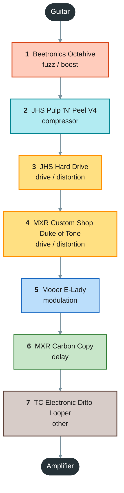
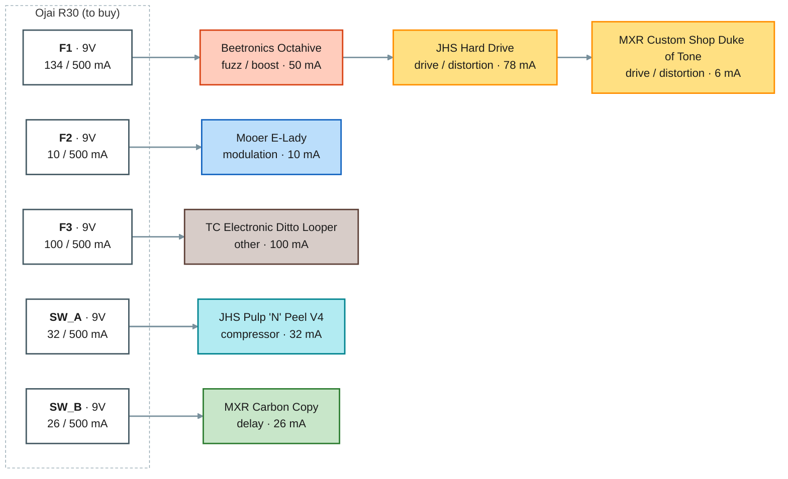

# Guitar practice board

> Generated by `scripts/build.py` from `catalog/` and this folder's `project.json`. Edit those, not this file.

- **Instrument:** guitar
- **Board:** Rockboard by Warwick Duo 2.1 (461 x 146 mm)
- **Validation:** OK, 0 warning(s) (`no_unknown` on)

## Signal chain

| # | Pedal | Owned | Accepts | Runs at | Draw | Bypass | Digital | Powered from |
|--:|---|:-:|---|---|--:|---|:-:|---|
| 1 | Beetronics Octahive | Yes | 9V | 9V | 50 mA | True | No | Ojai R30 · F1 |
| 2 | JHS Pulp 'N' Peel V4 | No | 9V | 9V | 32 mA | Buffered (switchable) | No | Ojai R30 · SW_A |
| 3 | JHS Hard Drive | No | 9V | 9V | 78 mA | Buffered | No | Ojai R30 · F1 |
| 4 | MXR Custom Shop Duke of Tone | Yes | 9-18V | 9V | 6 mA | True | No | Ojai R30 · F1 |
| 5 | Mooer E-Lady | Yes | 9V | 9V | 10 mA | True | No | Ojai R30 · F2 |
| 6 | MXR Carbon Copy | Yes | 9V | 9V | 26 mA | True | No | Ojai R30 · SW_B |
| 7 | TC Electronic Ditto Looper | Yes | 9V | 9V | 100 mA | True | Yes | Ojai R30 · F3 |

**To buy:** JHS Pulp 'N' Peel V4, JHS Hard Drive

### Ordering rules

- **Beetronics Octahive** must be first in the chain: Fuzz first `[project]`
- **JHS Pulp 'N' Peel V4** must come after Beetronics Octahive: Compressor after the fuzz `[project]`
- **JHS Hard Drive** must come after JHS Pulp 'N' Peel V4: Hard Drive after the compressor `[project]`
- **MXR Custom Shop Duke of Tone** must come after JHS Hard Drive: Duke of Tone after the Hard Drive `[project]`
- **Mooer E-Lady** must come after MXR Custom Shop Duke of Tone: E-Lady after the Duke of Tone `[project]`
- **MXR Carbon Copy** must come after Mooer E-Lady: Delay after the E-Lady `[project]`
- **TC Electronic Ditto Looper** must be last in the chain: Looper last `[project]`

### Notes per pedal

- **Beetronics Octahive**: High-octave fuzz. Planned for the practice board. 70 mA per a site you found (source not recorded, not a manufacturer figure; Effects Database lists the v2 as 9V DC center-negative with no mA). Check which version you own. Power re-checked 2026-10-21: the v2 manual and Beetronics FAQ say 50 mA at 9V (v1: 10 mA, retailer only).
- **JHS Pulp 'N' Peel V4**: Planned for the practice board. Compressor/preamp. 'Under 100 mA' is the published rating (planning on 100 mA; no measured figure found), 9V DC center-negative, no battery operation. A side switch turns the internal buffer on (buffered bypass) or off (true bypass): buffer switched ON in this plan (per owner). Analog. Power re-checked 2026-10-21: JHS's current page says 32 mA at 9V (the older 'under 100 mA' copy is outdated); 9V only, no 18V.
- **JHS Hard Drive**: Planned for the practice board. Distortion (cascaded gain stages, hard limiting, class AB output stage, Baxandall EQ). 78 mA at 9V DC center-negative per retailers; no battery operation. Buffered bypass (soft-touch silent footswitch; listings say true bypass 'no'). Analog. Power re-checked 2026-10-21: 9V ONLY; the manual says it doubles 9V to 18V inside (charge pump) and higher input voids the warranty.
- **MXR Custom Shop Duke of Tone**: Overdrive (CSP039). Planned for the practice board. 6 mA at 9V, no battery option; Dunlop recommends the ECB003 or an MXR Brick. One retailer mentions 18V for extra headroom, not confirmed by Dunlop, so allowed at 9V only here. Power re-checked 2026-10-21: Dunlop's product page says 18V gives extra headroom and clarity, so 9-18V (no current figure at 18V).
- **Mooer E-Lady**: Analog flanger (Mooer Electric Lady). Planned for the practice board. 10 mA per retailers, 9V DC center-negative, no battery (too small to fit one), true bypass.
- **MXR Carbon Copy**: Analog BBD delay (M169). 26 mA, 9V DC center-negative, true bypass (retailer specs; one UK retailer lists it as end of life). Planned for the practice board.
- **TC Electronic Ditto Looper**: Looper. Planned for the practice board. 100 mA is the minimum supply rating (retailers/Rockboard), not a measured draw. 9V DC center-negative, no battery. One reviewer saw a nominal-9V supply output higher than 9V and kill it: use a regulated/isolated output.

## Powering

Every output and the pedals daisy-chained on it, grouped for power (not in signal order); colors are the effect categories, a red border marks an 18V output.

Draw figures are the worst-case values in `catalog/pedals.json`. Pedals are daisy-chained by **effect type**, not by chain order: time-based/clocked effects (BBD or digital) never share an output with compressors or gain pedals, a **digital** pedal (including one with a digital processor in an analog path) always has an output to itself, and 18V-capable pedals share 18V outputs. The build checks all three (policy in `project.json`: `power_policy`).

### Ojai R30 (to buy)

Placement: under the board. Layout item: no layout.

| Output | Voltage | Pedal | Draw (mA) | Output total |
|---|--:|---|--:|--:|
| **F1** (fixed) | 9V | Beetronics Octahive | 50 | 134 / 500 mA |
|  | 9V | JHS Hard Drive | 78 |  |
|  | 9V | MXR Custom Shop Duke of Tone | 6 |  |
| **F2** (fixed) | 9V | Mooer E-Lady | 10 | 10 / 500 mA |
| **F3** (fixed) | 9V | TC Electronic Ditto Looper | 100 | 100 / 500 mA |
| **SW_A** (switchable) | 9V | JHS Pulp 'N' Peel V4 | 32 | 32 / 500 mA |
| **SW_B** (switchable) | 9V | MXR Carbon Copy | 26 | 26 / 500 mA |
| | | **Ojai R30 total** | | **302 mA** |

**All supplies combined:** 302 mA

## Jacks and cables

Jack data: 8 of 8 catalog items set up (pedals and supplies in this project).

*no playground_design.json: cable lengths and clearance are not checked.*

## Cable routing

Signal cables are routed on the board surface between the pedals: never under the board, never in front of the lowest pedals, at most 3.5 mm beyond the back and sides, at most 2 cables stacked in one 2 mm cell (cable width on the board 3.5 mm). Plugs are modelled (default cable type `ernie_ball_flat_patch_ra`, catalog/cables.json): a right-angle plug's cable leaves the head to the left or right of the jack's facing (chosen per end: fewest blocked plugs and plug collisions, then the shortest route), runs 3.5 mm straight, then is routed. Power cables are listed, not routed; their plug at each pedal's power jack is modelled for clearance (`dc_ra_owner_baseline`, exit side in the Exits column).

Min length = the shortest cable that reaches: measured from a point on each jack's axis half the clearance depth in front of the jack (half the plug head depth), along the plug's cable exit and the routed path. No slack or rounding is added. '~' marks a power cable that is not routed: a right-angle estimate between its jacks (with the project's default DC plug type). A routed power cable's Under board column gives its passes (holes, edges), the mm under the board and the mm on top. A power cable you buy is P#; a daisy chain with several plugs is one cable whose legs (plug to plug) are P#.1, P#.2... (see the table of DC cables to buy below).

| Cable | Kind | From | To | Type | Exits | Tips | Polarity | Under board | Min length (mm) | Status |
|---|---|---|---|---|---|---|---|:-:|--:|---|
| S1 | signal | octahive.out | jhs_pulp_n_peel_v4.in | ernie_ball_flat_patch_ra | - / - | TS / TS | - | no | ? | not routed |
| S2 | signal | jhs_pulp_n_peel_v4.out | jhs_hard_drive.in | ernie_ball_flat_patch_ra | - / - | TS / TS | - | no | ? | not routed |
| S3 | signal | jhs_hard_drive.out | duke_of_tone.in | ernie_ball_flat_patch_ra | - / - | TS / TS | - | no | ? | not routed |
| S4 | signal | duke_of_tone.out | e_lady.in | ernie_ball_flat_patch_ra | - / - | TS / TS | - | no | ? | not routed |
| S5 | signal | e_lady.out | carbon_copy.in | ernie_ball_flat_patch_ra | - / - | TS / TS | - | no | ? | not routed |
| S6 | signal | carbon_copy.out | ditto_looper.in | ernie_ball_flat_patch_ra | - / - | TS / TS | - | no | ? | not routed |

## Footswitches

Footswitch data: 7 of 7 pedals (catalog/footswitches.json).

*No playground_design.json: footswitch spacing is not checked.*

