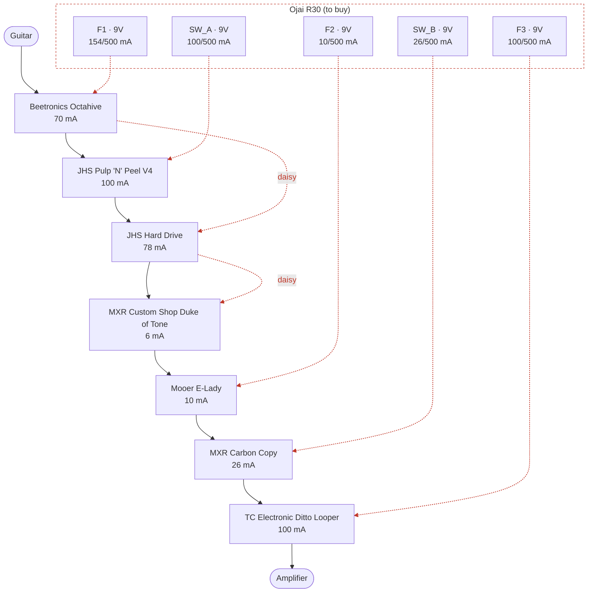

# Guitar practice board

> Generated by `scripts/build.py` from `catalog/` and this folder's `project.json`. Edit those, not this file.

- **Instrument:** guitar
- **Board:** Rockboard by Warwick Duo 2.1 (18.13 x 5.75 in)
- **Validation:** OK, 0 warning(s) (`no_unknown` on)

## Signal chain

| # | Pedal | Owned | Power | Bypass | Digital | Powered from |
|--:|---|:-:|---|---|:-:|---|
| 1 | Beetronics Octahive | Yes | 9V, 70 mA | True | No | Ojai R30 · F1 |
| 2 | JHS Pulp 'N' Peel V4 | No | 9V, 100 mA | Buffered (switchable) | No | Ojai R30 · SW_A |
| 3 | JHS Hard Drive | No | 9V, 78 mA | Buffered | No | Ojai R30 · F1 |
| 4 | MXR Custom Shop Duke of Tone | Yes | 9V, 6 mA | True | No | Ojai R30 · F1 |
| 5 | Mooer E-Lady | Yes | 9V, 10 mA | True | No | Ojai R30 · F2 |
| 6 | MXR Carbon Copy | Yes | 9V, 26 mA | True | No | Ojai R30 · SW_B |
| 7 | TC Electronic Ditto Looper | Yes | 9V, 100 mA | True | Yes | Ojai R30 · F3 |

**To buy:** JHS Pulp 'N' Peel V4, JHS Hard Drive

### Ordering rules

- **Beetronics Octahive** must be first in the chain: Fuzz first `[project]`
- **JHS Pulp 'N' Peel V4** must come after Beetronics Octahive: Compressor after the fuzz `[project]`
- **JHS Hard Drive** must come after JHS Pulp 'N' Peel V4: Hard Drive after the compressor `[project]`
- **MXR Custom Shop Duke of Tone** must come after JHS Hard Drive: Duke of Tone after the Hard Drive `[project]`
- **Mooer E-Lady** must come after MXR Custom Shop Duke of Tone: E-Lady after the Duke of Tone `[project]`
- **MXR Carbon Copy** must come after Mooer E-Lady: Delay after the E-Lady `[project]`
- **TC Electronic Ditto Looper** must be last in the chain: Looper last `[project]`

### Notes per pedal

- **Beetronics Octahive**: High-octave fuzz. Planned for the practice board. 70 mA per a site you found (source not recorded, not a manufacturer figure; Effects Database lists the v2 as 9V DC center-negative with no mA). Check which version you own.
- **JHS Pulp 'N' Peel V4**: Planned for the practice board. Compressor/preamp. 'Under 100 mA' is the published rating (planning on 100 mA; no measured figure found), 9V DC center-negative, no battery operation. A side switch turns the internal buffer on (buffered bypass) or off (true bypass): buffer switched ON in this plan (per owner). Analog.
- **JHS Hard Drive**: Planned for the practice board. Distortion (cascaded gain stages, hard limiting, class AB output stage, Baxandall EQ). 78 mA at 9V DC center-negative per retailers; no battery operation. Buffered bypass (soft-touch silent footswitch; listings say true bypass 'no'). Analog.
- **MXR Custom Shop Duke of Tone**: Overdrive (CSP039). Planned for the practice board. 6 mA at 9V, no battery option; Dunlop recommends the ECB003 or an MXR Brick. One retailer mentions 18V for extra headroom, not confirmed by Dunlop, so allowed at 9V only here.
- **Mooer E-Lady**: Analog flanger (Mooer Electric Lady). Planned for the practice board. 10 mA per retailers, 9V DC center-negative, no battery (too small to fit one), true bypass.
- **MXR Carbon Copy**: Analog BBD delay (M169). 26 mA, 9V DC center-negative, true bypass (retailer specs; one UK retailer lists it as end of life). Planned for the practice board.
- **TC Electronic Ditto Looper**: Looper. Planned for the practice board. 100 mA is the minimum supply rating (retailers/Rockboard), not a measured draw. 9V DC center-negative, no battery. One reviewer saw a nominal-9V supply output higher than 9V and kill it: use a regulated/isolated output.

## Powering

Draw figures are the worst-case values in `catalog/pedals.json`. Pedals are daisy-chained by **effect type**, not by chain order: time-based/clocked effects (BBD or digital) never share an output with compressors or gain pedals, a **digital** pedal (including one with a digital processor in an analog path) always has an output to itself, and 18V-capable pedals share 18V outputs. The build checks all three (policy in `project.json`: `power_policy`).

### Ojai R30 (to buy)

| Output | Voltage | Pedal | Draw (mA) | Output total |
|---|--:|---|--:|--:|
| **F1** (fixed) | 9V | Beetronics Octahive | 70 | 154 / 500 mA |
|  | 9V | JHS Hard Drive | 78 |  |
|  | 9V | MXR Custom Shop Duke of Tone | 6 |  |
| **F2** (fixed) | 9V | Mooer E-Lady | 10 | 10 / 500 mA |
| **F3** (fixed) | 9V | TC Electronic Ditto Looper | 100 | 100 / 500 mA |
| **SW_A** (switchable) | 9V | JHS Pulp 'N' Peel V4 | 100 | 100 / 500 mA |
| **SW_B** (switchable) | 9V | MXR Carbon Copy | 26 | 26 / 500 mA |
| | | **Ojai R30 total** | | **390 mA** |

**All supplies combined:** 390 mA

