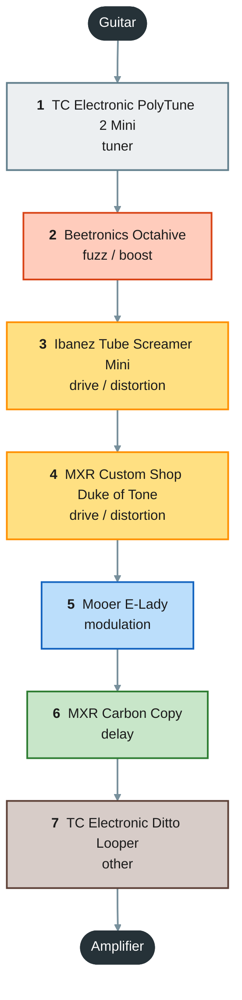
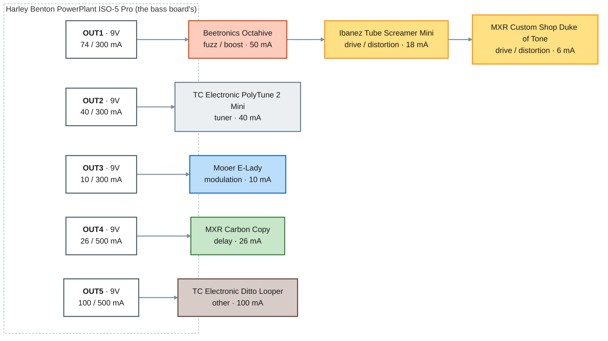
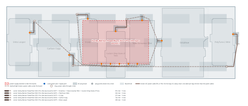
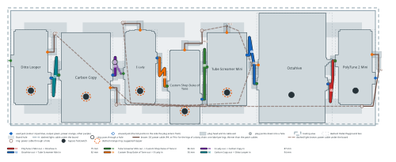

# Guitar practice board

> Generated by `scripts/build.py` from `catalog/` and this folder's `project.json`. Edit those, not this file.

- **Instrument:** guitar
- **Board:** Rockboard by Warwick Duo 2.1 (461 x 146 mm)
- **Validation:** OK, 2 warning(s) (`no_unknown` on)

Validation messages

- WARN clearance: polytune_2_mini.out (Output, facing left, ernie_ball_flat_patch_ra right-angle plug, cable exits left) is blocked by Beetronics Octahive: it reaches 2.6 mm into the plug's head
- WARN clearance: carbon_copy.out (Output, ernie_ball_flat_patch_ra right-angle plug, cable exits right) collides with the plug at ditto_looper.in (ernie_ball_flat_patch_ra plug): 2.6 mm (its head into the head)

## Signal chain

| # | Pedal | Owned | Accepts | Runs at | Draw | Bypass | Digital | Powered from |
|--:|---|:-:|---|---|--:|---|:-:|---|
| 1 | TC Electronic PolyTune 2 Mini | Yes | 9V | 9V | 40 mA | True | Yes | Harley Benton PowerPlant ISO-5 Pro · OUT2 |
| 2 | Beetronics Octahive | Yes | 9V | 9V | 50 mA | True | No | Harley Benton PowerPlant ISO-5 Pro · OUT1 |
| 3 | Ibanez Tube Screamer Mini | Yes | 9V | 9V | 18 mA | True | No | Harley Benton PowerPlant ISO-5 Pro · OUT1 |
| 4 | MXR Custom Shop Duke of Tone | Yes | 9-18V | 9V | 6 mA | True | No | Harley Benton PowerPlant ISO-5 Pro · OUT1 |
| 5 | Mooer E-Lady | Yes | 9V | 9V | 10 mA | True | No | Harley Benton PowerPlant ISO-5 Pro · OUT3 |
| 6 | MXR Carbon Copy | Yes | 9V | 9V | 26 mA | True | No | Harley Benton PowerPlant ISO-5 Pro · OUT4 |
| 7 | TC Electronic Ditto Looper | Yes | 9V | 9V | 100 mA | True | Yes | Harley Benton PowerPlant ISO-5 Pro · OUT5 |

**To buy:** nothing

### Ordering rules

- **TC Electronic PolyTune 2 Mini** must be first in the chain (priority 100): Tuner first (owner layout 2026-11-04); true bypass, so the fuzz still sees the guitar directly when it is off `[project]`
- **Beetronics Octahive** must be first in the chain: Fuzz first among the effects (only the tuner is ahead of it) `[project]`
- **Ibanez Tube Screamer Mini** must come after Beetronics Octahive: Tube Screamer after the fuzz (owner's layout, 2026-11-09) `[project]`
- **MXR Custom Shop Duke of Tone** must come after Ibanez Tube Screamer Mini: Duke of Tone after the Tube Screamer (owner's layout, 2026-11-09) `[project]`
- **MXR Custom Shop Duke of Tone** must come after Beetronics Octahive: Duke of Tone after the fuzz (owned pedals only, 2026-11-04: the Pulp n' Peel and Hard Drive are not bought) `[project]`
- **Mooer E-Lady** must come after MXR Custom Shop Duke of Tone: E-Lady after the Duke of Tone `[project]`
- **MXR Carbon Copy** must come after Mooer E-Lady: Delay after the E-Lady `[project]`
- **TC Electronic Ditto Looper** must be last in the chain: Looper last `[project]`

### Overridden by priority

- `polytune_2_mini.first` overrides `octahive.first` for: octahive before polytune_2_mini

### Notes per pedal

- **TC Electronic PolyTune 2 Mini**: Currently planned for the bass board (may move to the practice board). The Mini, not the full-size PolyTune 2 (owner confirmed). About 40 mA typical per TC's specs, 9V DC center-negative, adapter not included; no battery operation on the Mini. True bypass (no buffer); output mutes while tuning. Digital is inferred from the polyphonic display (no source states it explicitly). Power re-checked 2026-10-21: 40 mA typical (retailer); one Q&A says use a 100 mA supply; no maker figure found.
- **Beetronics Octahive**: High-octave fuzz. Planned for the practice board. 70 mA per a site you found (source not recorded, not a manufacturer figure; Effects Database lists the v2 as 9V DC center-negative with no mA). The owner's unit is the V1 (owner, 2026-11-06). Power re-checked 2026-10-21: the v2 manual and Beetronics FAQ say 50 mA at 9V (v1: 10 mA, retailer only); 50 mA kept as the worst case (the V1 figure is retailer-only).
- **Ibanez Tube Screamer Mini**: Owner's practice-board overdrive (owned). 100% analog TS808-type circuit (JRC4558), controls Overdrive / Tone / Level. Power: external DC 9 V only, no battery; 18 mA at 9 V, center-negative (Ibanez product page: 'Required Current: 18mA@9V', 'External DC 9 volt AC adapter (Center-negative)').
- **MXR Custom Shop Duke of Tone**: Overdrive (CSP039). Planned for the practice board. 6 mA at 9V, no battery option; Dunlop recommends the ECB003 or an MXR Brick. One retailer mentions 18V for extra headroom, not confirmed by Dunlop, so allowed at 9V only here. Power re-checked 2026-10-21: Dunlop's product page says 18V gives extra headroom and clarity, so 9-18V (no current figure at 18V).
- **Mooer E-Lady**: Analog flanger (Mooer Electric Lady). Planned for the practice board. 10 mA per retailers, 9V DC center-negative, no battery (too small to fit one), true bypass.
- **MXR Carbon Copy**: Analog BBD delay (M169). 26 mA, 9V DC center-negative, true bypass (retailer specs; one UK retailer lists it as end of life). Planned for the practice board.
- **TC Electronic Ditto Looper**: Looper. Planned for the practice board. 100 mA is the minimum supply rating (retailers/Rockboard), not a measured draw. 9V DC center-negative, no battery. One reviewer saw a nominal-9V supply output higher than 9V and kill it: use a regulated/isolated output.

### Floor devices

Not on the board (they sit on the floor and are shared by every board, `floor` in project.json); the jacks they drive count as used extra jacks (clearance and plug checks). Their cables are not routed or measured.

- **Dunlop Cry Baby GCB95F Classic** drives nothing on this board: Wah on the floor, in the signal path off the board (its position and cable are not modelled; owner, 2026-11-13)

## Powering

Every output and the pedals daisy-chained on it, grouped for power (not in signal order); colors are the effect categories, a red border marks an 18V output.

Draw figures are the worst-case values in `catalog/pedals.json`. Pedals are daisy-chained by **effect type**, not by chain order: time-based/clocked effects (BBD or digital) never share an output with compressors or gain pedals, a **digital** pedal (including one with a digital processor in an analog path) always has an output to itself, and 18V-capable pedals share 18V outputs. The build checks all three (policy in `project.json`: `power_policy`).

### Harley Benton PowerPlant ISO-5 Pro (the bass board's)

Placement: under the board. Layout item: Harley Benton PowerPlant ISO-1AC Pro (69d1b8e5-3b68-4656-8e60-86f39fc210cb).

| Output | Voltage | Pedal | Draw (mA) | Output total |
|---|--:|---|--:|--:|
| **OUT1** (fixed) | 9V | Beetronics Octahive | 50 | 74 / 300 mA |
|  | 9V | Ibanez Tube Screamer Mini | 18 |  |
|  | 9V | MXR Custom Shop Duke of Tone | 6 |  |
| **OUT2** (fixed) | 9V | TC Electronic PolyTune 2 Mini | 40 | 40 / 300 mA |
| **OUT3** (fixed) | 9V | Mooer E-Lady | 10 | 10 / 300 mA |
| **OUT4** (switchable) | 9V | MXR Carbon Copy | 26 | 26 / 500 mA |
| **OUT5** (switchable) | 9V | TC Electronic Ditto Looper | 100 | 100 / 500 mA |
| | | **Harley Benton PowerPlant ISO-5 Pro total** | | **250 mA** |

**All supplies combined:** 250 mA

## Jacks and cables

Jack data: 8 of 8 catalog items set up (pedals and supplies in this project).

Blocked cable space (signal jacks with a cable type: the plug head plus its cable exit on the side the router chose (see Cable routing); power jacks: the DC plug head plus its cable exit on the less blocked side; other jacks: 6.3 mm outward, 7 mm to each side):

- `polytune_2_mini.out` is blocked by Beetronics Octahive: 2.6 mm into the head of the ernie_ball_flat_patch_ra plug, cable exits left

Plug collisions (a plug's head, barrel or cable run overlapping another jack's plug or fixed box; the side choice avoids them where it can):

- carbon_copy.out (Output, ernie_ball_flat_patch_ra right-angle plug, cable exits right) collides with the plug at ditto_looper.in (ernie_ball_flat_patch_ra plug): 2.6 mm (its head into the head)

DC plugs that pass under a signal plug (a right-angle DC plug is plugged diagonally and its cable goes under the patch cables; not a collision, one pass per plug):

- P1.1 (octahive.power) passes under the plug at octahive.out: plug it diagonally

Cable lengths: see Cable routing.

## Cable routing

Signal cables are routed on the board surface between the pedals: never in front of the lowest pedals, at most 3.5 mm beyond the board edges at the back and sides, at most 2 cables stacked in one 2 mm cell (cable width on the board 3.5 mm). A cable may also pass under the board when that is shorter or less crowded: it goes down in a hole cell (a grid cell whose centre lies in a hole that no pedal covers), runs under the board (only the under-board supplies are obstacles there, at most 2 cables stacked) and comes up in a hole. A pass through the deck adds 15 mm of cable, each costs 15 mm more in the search, a mm under the board counts 0.9 in the search (these numbers are unverified estimates; `cables.under_board: false` keeps every cable on top). Plugs are modelled (default cable type `ernie_ball_flat_patch_ra`, catalog/cables.json): a right-angle plug's cable leaves the head to the left or right of the jack's facing (chosen per end: fewest blocked plugs and plug collisions, then the shortest route), runs 3.5 mm straight, then is routed. A right-angle plug may also point straight down into a board hole (`down` in the Exits column; the square of one cable width at the plug's bend point must lie inside the holes and clear of the under-board supplies): where that is possible it is always chosen, even if the cable gets longer, and the cable continues under the board. The cable down to the hole is the jack height (`cables.jack_height_mm`, 12 mm, an unverified estimate of the jack axis above the deck) plus the deck (15 mm). `cables.overrides.<id>.exit_a` / `exit_b` accept `down`. Power cables are routed with the same router on their own grid (3.2 mm wide; plug `dc_ra_owner_baseline`, exit side in the Exits column) and count against each other only: at most 2 stacked per cell and layer, at most 2 across a power plug. They stay under the board as much as they can: a cable from an under-board supply port starts under the board and comes up through the usable hole nearest its pedal's power jack (a hole cell no pedal covers) or round the board edge along an edge segment the owner drew in the board editor (`board.json`, type `edge`; none drawn: holes only; with neither holes nor edge segments an under-board supply is an error), then runs the short way on top to the jack; a hop from a pedal's power jack (daisy chain) or from an on-board supply starts on top. In the search a mm on top counts 3 (under the board 1). A pass through a hole adds 15 mm of cable and a crossing of the board edge 30 mm (both unverified estimates; the edge value is twice the hole transit). A power cable that runs more than 150 mm on top is reported.

`power.svg` shows the power wiring alone: the supplies as translucent red silhouettes (dashed when they hang under the board), the pedals faint, the power jacks and supply ports, the DC cables (dashed under the board, a ring at each hole, a square at each board edge) and a table of the power cables.

Pedals are obstacles by their outlines (`catalog/outlines.json`), their Pedal Playground box where there is none. No outline: Ibanez Tube Screamer Mini.

The picture (`routing.svg`) is drawn in mm and prints at 1:1 from a browser: the board, the routing area (dashed), the pedals, every jack (coloured by function, filled when used, the tick on the side the plug enters from), the plug heads (grey boxes) with their cable exits, the cables (one colour each; side by side in lanes where they share a corridor, white dashes where they are stacked; under the board: lighter and dashed, a ring at each hole pass, a square at each edge pass, the edge segments as thick purple lines on the board border), the footswitches and a legend table with each cable's minimum length. `uv run scripts/build.py --images` also writes the git-ignored `routing.local.svg` with the pedal images.

Min length = the shortest cable that reaches: measured from a point on each jack's axis half the clearance depth in front of the jack (half the plug head depth), along the plug's cable exit and the routed path. No slack or rounding is added. '~' marks a power cable that is not routed: a right-angle estimate between its jacks (with the project's default DC plug type). A routed power cable's Under board column gives its passes (holes, edges), the mm under the board and the mm on top. A power cable you buy is P#; a daisy chain with several plugs is one cable whose legs (plug to plug) are P#.1, P#.2... (see the table of DC cables to buy below).

| Cable | Kind | From | To | Type | Exits | Tips | Polarity | Under board | Min length (mm) | Status |
|---|---|---|---|---|---|---|---|:-:|--:|---|
| S1 | signal | polytune_2_mini.out | octahive.in | ernie_ball_flat_patch_ra | left / right | TS / TS | - | no | 75 | routed |
| S2 | signal | octahive.out | ibanez_ts_mini.in | ernie_ball_flat_patch_ra | right / left | TS / TS | - | no | 82 | routed |
| S3 | signal | ibanez_ts_mini.out | duke_of_tone.in | ernie_ball_flat_patch_ra | right / left | TS / TS | - | no | 86 | routed |
| S4 | signal | duke_of_tone.out | e_lady.in | ernie_ball_flat_patch_ra | right / right | TS / TS | - | no | 56 | routed |
| S5 | signal | e_lady.out | carbon_copy.in | ernie_ball_flat_patch_ra | down / left | TS / TS | - | yes (1 hole, 16 mm) | 87 | routed |
| S6 | signal | carbon_copy.out | ditto_looper.in | ernie_ball_flat_patch_ra | right / right | TS / TS | - | no | 94 | routed |
| P1.1 | power | psu1.OUT1 | octahive.power | dc_ra_owner_baseline | - / down | DC 2.1 mm / DC 2.1 mm | center_negative | no pass; 148 mm under, 0 mm on top | 177 | routed |
| P1.2 | power | octahive.power | ibanez_ts_mini.power | dc_ra_owner_baseline | - / down | DC 2.1 mm / DC 2.1 mm | center_negative | no pass; 63 mm under, 0 mm on top | 121 | routed |
| P1.3 | power | ibanez_ts_mini.power | duke_of_tone.power | dc_ra_owner_baseline | - / right | DC 2.1 mm / DC 2.1 mm | center_negative | 1 hole; 32 mm under, 16 mm on top | 117 | routed |
| P2 | power | psu1.OUT2 | polytune_2_mini.power | dc_ra_owner_baseline | - / right | DC 2.1 mm / DC 2.1 mm | center_negative | 1 hole; 234 mm under, 58 mm on top | 332 | routed |
| P3 | power | psu1.OUT3 | e_lady.power | dc_ra_owner_baseline | - / left | DC 2.1 mm / DC 2.1 mm | center_negative | 1 hole; 178 mm under, 1 mm on top | 219 | routed |
| P4 | power | psu1.OUT4 | carbon_copy.power | dc_ra_owner_baseline | - / right | DC 2.1 mm / DC 2.1 mm | center_negative | 1 hole; 112 mm under, 1 mm on top | 152 | routed |
| P5 | power | psu1.OUT5 | ditto_looper.power | dc_ra_owner_baseline | - / left | DC 2.1 mm / DC 2.1 mm | center_negative | 1 hole; 242 mm under, 1 mm on top | 283 | routed |

Signal cable, minimum: 480 mm over 6 cables.

### DC cables to buy

Each row is one DC cable P#. A **serial** output is one cable that runs from the supply port to the first pedal and on to the next ones (a plug at the port and one at each pedal); its legs P#.1, P#.2... (in daisy order, P#.1 starts at the supply port) are the stretches between two consecutive plugs, and the minimum spacing between those plugs is each leg's minimum length. A cable with a single leg is just P#. A **forked** output has one cable per pedal, each from the supply port (a splitter or several plugs at the port). The cable's minimum length is the sum of its legs; lengths are minimums, as above ('~': a right-angle estimate with the default DC plug type, the cable is not routed).

| DC cable | Style | Output | Route | Plugs | Min plug spacing per leg (mm) | Min length (mm) | Status |
|---|---|---|---|--:|---|--:|---|
| P1 | serial | psu1_OUT1 | psu1.OUT1 -> octahive -> ibanez_ts_mini -> duke_of_tone | 4 | P1.1 177 / P1.2 121 / P1.3 117 | 416 | routed |
| P2 | serial | psu1_OUT2 | psu1.OUT2 -> polytune_2_mini | 2 | - | 332 | routed |
| P3 | serial | psu1_OUT3 | psu1.OUT3 -> e_lady | 2 | - | 219 | routed |
| P4 | serial | psu1_OUT4 | psu1.OUT4 -> carbon_copy | 2 | - | 152 | routed |
| P5 | serial | psu1_OUT5 | psu1.OUT5 -> ditto_looper | 2 | - | 283 | routed |

DC cable, minimum: 1402 mm over 5 cables (5 serial, 0 forked).

## Footswitches

Footswitch data: 7 of 7 pedals (catalog/footswitches.json).

Spacing is comfort, not a hard rule: switches of different pedals should be as far apart as the other goals allow. Crowding of a pair = priority x (comfort - distance)^2 / comfort for pairs closer than the comfort distance (100 mm, `footswitches.comfort_mm`; distance centre to centre; priority per switch type, `footswitches.priority`); lower is better, the layout proposals minimise it. No minimum distance is set. Switches on the same pedal are not checked. Type: bypass (turns the pedal, or one side of it, on and off), tap (tap tempo), boost (a boost / extra-gain stomp), function (any other switch).

Toppers (a larger, higher cap on a switch) are a finishing step after the layout; the layout search ignores them. A topper adds 4.5 mm (`footswitches.topper_bonus_mm`; default: the height a topper adds, a rough proxy, unverified) to the effective distance of every pair its switch is in (both switches of a pair: twice); crowding uses the effective distance. No toppers are set.

Crowding: 57.5 (6 of 21 pairs closer than 100 mm). Closest pairs (8 of 21):

| Switch | Type | Switch | Type | Distance (mm) | Crowding |
|---|---|---|---|--:|--:|
| ibanez_ts_mini.bypass | bypass | duke_of_tone.bypass | bypass | 58.5 | 17.2 |
| duke_of_tone.bypass | bypass | e_lady.bypass | bypass | 62.0 | 14.4 |
| e_lady.bypass | bypass | carbon_copy.bypass | bypass | 68.6 | 9.8 |
| carbon_copy.bypass | bypass | ditto_looper.bypass | bypass | 70.1 | 9.0 |
| polytune_2_mini.bypass | bypass | octahive.bypass | bypass | 81.1 | 3.6 |
| octahive.bypass | bypass | ibanez_ts_mini.bypass | bypass | 81.4 | 3.5 |
| ibanez_ts_mini.bypass | bypass | e_lady.bypass | bypass | 109.8 | 0.0 |
| duke_of_tone.bypass | bypass | carbon_copy.bypass | bypass | 126.0 | 0.0 |

### Suggested toppers

Chosen after the layout (never during the search), on bypass switches only (a tap switch gets one by hand, a boost switch never), greedily: the topper that removes the most crowding first (a switch in several close pairs helps them all; ties: the switch in more crowded pairs, then the higher priority type, then nearer the front), at most 5 in all (`footswitches.max_toppers`), stopping when a topper would remove less than 2 % of the crowding (`footswitches.topper_min_gain`). Not applied: list the ones you want in `footswitches.toppers`.

| # | Switch | Pedal | Type | Crowding removed | Crowding after |
|--:|---|---|---|--:|--:|
| 1 | duke_of_tone.bypass (Bypass) | MXR Custom Shop Duke of Tone | bypass | 6.8 | 50.8 |
| 2 | e_lady.bypass (Bypass) | Mooer E-Lady | bypass | 5.4 | 45.3 |
| 3 | carbon_copy.bypass (Bypass) | MXR Carbon Copy | bypass | 4.7 | 40.6 |
| 4 | ibanez_ts_mini.bypass (Bypass) | Ibanez Tube Screamer Mini | bypass | 4.6 | 36.0 |
| 5 | octahive.bypass (Bypass) | Beetronics Octahive | bypass | 2.6 | 33.5 |

Stopped at the cap `footswitches.max_toppers` (5).

## Layout proposals

None yet: `uv run scripts/propose_layout.py guitar-practice` searches for better pedal positions (it never changes playground_design.json).

